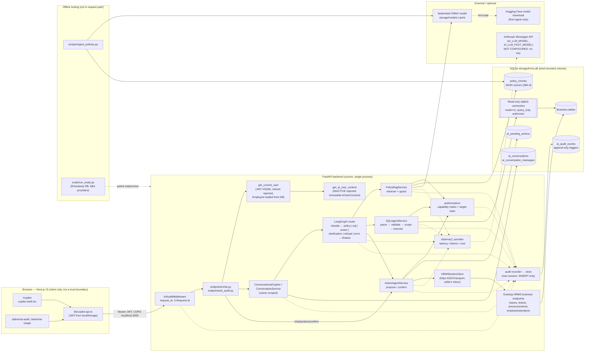
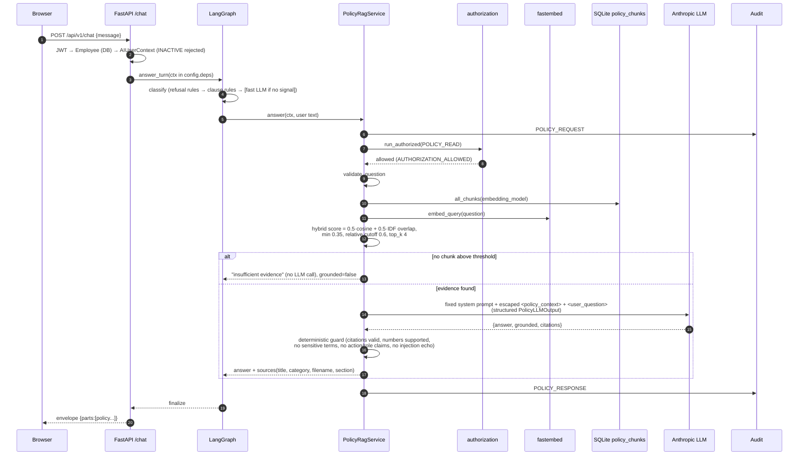

# AI Components, Architecture and Production Readiness Assessment

**Project:** CB Nest — NovaWorks PeopleOps AI HR Copilot
**Assessment date:** 2026-10-11
**Scope:** every AI-related component in this repository, checked against the code itself, the tests, and runtime checks on the current development machine.
**Companion document:** [ai-components-inventory.md](ai-components-inventory.md) (short status inventory and prioritized gap list).

> **How to read this document**
> - Paths are relative to `HRMS-main/`, and line numbers refer to the working tree on 2026-10-11.
> - Each component has a status:
>   - **IMPLEMENTED** means code exists and tests or runtime checks confirm it.
>   - **PARTIALLY IMPLEMENTED** means part of the capability exists.
>   - **CONFIGURED BUT UNVERIFIED** means configuration exists but nothing has shown it working.
>   - **NOT IMPLEMENTED** means a reasonable code search found nothing.
>   - **NOT APPLICABLE** means this architecture doesn't need it.
> - Evidence is labelled by where it came from:
>   - `[code]` — the source code.
>   - `[test]` — a test exists. That doesn't mean it was run during this assessment.
>   - `[runtime 2026-10-10/11]` — run on this machine during this engagement.
>   - `[inherited 2026-10-03]` — reported by the previous machine's Phase 10 handoff and not re-run here.
> - The assessment was read-only. The only working-tree changes during this engagement were made in earlier, separately approved tasks; see §0.

---

## 0. Assessment context and evidence provenance

| Item | Value |
|---|---|
| Git HEAD | `c685e8b Phase 10 complete - AI HR Copilot` |
| Uncommitted, approved changes (earlier tasks) | `backend/app/services/auth.py`: refresh-token rejection. `backend/tests/characterization/test_auth.py`: 2 regression cases. `frontend/Dockerfile`: `npm ci` with the lockfile. `backend/.env.example`: empty cost settings commented out. `backend/.dockerignore`: new. Plus an existing `CLAUDE.md` edit |
| Runtime environment | Windows 11, Docker Desktop 29.6.1 and Compose v5.2.0. The api image is `python:3.11-slim`, the web image `node:20-alpine` |
| Fresh backend test run | **1687 passed, 0 failed**, on 2026-10-10, Python 3.13 (the documented 3.12 isn't installed). The run includes the refresh-token fix. The local venv was later removed by OS temp cleanup, so **no tests were re-run during this assessment** |
| Fresh runtime checks [runtime 2026-10-10/11] | `docker compose up -d --build` succeeds; migrations reach `0020_ai_audit_events`; seed (once); policy ingestion (24 docs → 40 chunks, idempotent re-run); `/health`, `/api/v1/health` (DB connected); `/login` (HTTP 200); login for all three roles; refresh token → `401 INVALID_TOKEN`; `/chat/permissions` per role; AI endpoints return `503 AI_UNAVAILABLE` without a key; deterministic refusals; CORS from `localhost:3000`; audit API scoping per role |
| Not run on this machine | Frontend tests, `tsc`, `next build`, offline evaluations, live-model evaluation, any browser-based UI test |
| Inherited results [inherited 2026-10-03] | Frontend 86 passed, TypeScript 0 errors, `next build` PASS (23 routes), offline evaluations 139/139 (`docs/phase-10-final-report.md`) |
| `ANTHROPIC_API_KEY` | Not configured. **No live LLM call has ever been made in this repository's recorded history** |

---

## A. Executive summary

### What the system does
The Copilot adds a chat assistant to the existing CB Nest HRMS. Through one endpoint (`POST /api/v1/chat`), an authenticated employee, manager or admin can:
- ask **HR policy questions**, answered from the company policy library with citations (Policy RAG);
- ask **HR data questions**, answered by a **read-only, row-scoped SQL agent**;
- request **HR operations** (leave, tickets, announcements, projects, deactivation). These become **proposals**, which run only after the user confirms them through a separate endpoint, which calls the **existing HRMS business API with the user's own token**.

### Architecture in one paragraph
A Next.js client calls FastAPI. Every AI request passes through:
1. the existing JWT authentication;
2. a database-loaded, immutable `AIUserContext` (inactive users rejected);
3. an owner-scoped conversation store;
4. a **LangGraph state machine**, which dispatches to one of three specialised services (RAG, SQL, actions) or to a clarification or refusal node.

The routing rules are deterministic, with an optional fast-model fallback. A deterministic capability matrix makes every authorization decision; the LLM never does. Anthropic is the only LLM provider. Embeddings run locally with fastembed (`BAAI/bge-small-en-v1.5`, 384 dimensions). Vectors are stored as JSON in SQLite. Every AI request produces append-only audit events, which feed an admin audit log and a usage dashboard.

### Strongest controls (verified in code and tests)
1. **Deterministic authorization.** `services/ai/authorization/policy.py` is the only permission matrix. It is immutable, re-checked by every service, and never influenced by the model, prompt, history or frontend.
2. **SQL agent defence in depth:**
   - sqlglot parsing to an AST, rejecting anything that changes data;
   - table, column and function allowlists;
   - row scope enforced by **backend rewriting of every base table** into a scoped subquery, then re-verified;
   - a separate read-only SQLite connection (`mode=ro` + `query_only` + a per-query authorizer), plus a timeout and a row cap.
3. **Human confirmation for every data-changing action.** Each confirmation is single-use, bound by hash to the user, action, target and payload, expires, and has its permission re-checked at execution time. Typing "yes" in chat never executes anything.
4. **No direct business-table writes from AI code.** Actions call registered existing routes in-process with the caller's own bearer token.
5. **Append-only audit.** Database triggers block UPDATE and DELETE, and the metadata schema accepts only a fixed list of fields, so no prompts, answers, SQL or rows are stored.

### Major production-readiness gaps
1. **Live-model quality has never been measured.** All 139 evaluation cases use scripted model output, and the policy evaluation even uses fake hash embeddings. Real answer quality, SQL accuracy, action extraction and routing are unknown.
2. **No rate limiting, quotas or cost budgets** on AI endpoints.
3. **No retention or purge** for conversations, audit events or pending actions.
4. **Deployment is development-grade:** `uvicorn --reload`, `next dev`, root containers, SQLite single instance, Node 20 (end of life), and `next@15.5.2` with a published advisory (CVE-2025-66478).
5. **Data egress governance.** User questions, retrieved policy text and redacted SQL result rows (names, emails, leave reasons) are sent to the LLM provider. There is no documented data-processing decision.
6. **Reliability gaps in the action path:** the in-process business call has no effective timeout, and there's no reconciliation for unknown outcomes.
7. **No CI pipeline**, so tests and evaluations are not release gates.

### Deterministic evaluation vs live-model quality
The offline suites prove that **the pipelines behave correctly given a model output**: routing, guardrails, authorization, scope, confirmation and refusal. They do **not** show that a real model produces good answers, correct SQL or correct action proposals. The live harness covers router classification only, and has never been run.

### Component status at a glance

| Component | Status |
|---|---|
| LangGraph orchestration (dispatcher) | IMPLEMENTED |
| Intent classification: rules / LLM fallback | IMPLEMENTED / CONFIGURED BUT UNVERIFIED |
| Policy ingestion + chunking + fastembed embeddings | IMPLEMENTED |
| Vector, lexical and hybrid retrieval | IMPLEMENTED (brute force, small corpus) |
| Reranking | NOT IMPLEMENTED |
| Grounding guard + citations | IMPLEMENTED (deterministic) |
| SQL agent pipeline | IMPLEMENTED (live SQL generation unverified) |
| Action agent + human confirmation | IMPLEMENTED (live proposal extraction unverified) |
| AI RBAC (capability matrix) | IMPLEMENTED |
| Tenant isolation | NOT APPLICABLE (single tenant) |
| Prompt-injection containment / detection | IMPLEMENTED / PARTIALLY IMPLEMENTED (heuristic) |
| LLM provider abstraction / AI gateway | IMPLEMENTED / NOT IMPLEMENTED |
| Retries / provider fallback / circuit breaker | PARTIALLY IMPLEMENTED / NOT IMPLEMENTED / NOT IMPLEMENTED |
| Semantic, response or retrieval caching | NOT IMPLEMENTED |
| Conversation history / long-term memory | IMPLEMENTED / NOT IMPLEMENTED |
| Audit trail + usage metrics | IMPLEMENTED |
| Distributed tracing | PARTIALLY IMPLEMENTED (correlation only, no spans) |
| Offline evaluation / live evaluation / CI gates | IMPLEMENTED / CONFIGURED BUT UNVERIFIED / NOT IMPLEMENTED |
| Streaming / rate limiting / retention | NOT IMPLEMENTED |
| Production config checks | IMPLEMENTED |

---

## B. System architecture



**Key architectural facts** `[code]`:
- **Single process, single database.** SQLite through `aiosqlite` (`backend/app/db/session.py`). There's no vector database, cache server or message queue. The SQL agent uses its own synchronous `sqlite3` connection (`backend/app/services/ai/sql/executor.py`).
- **Actions don't leave the process.** `HRMSActionClient` sends HTTP requests to the same FastAPI app through `httpx.ASGITransport` (`backend/app/services/ai/actions/client.py:107-123`). The business route therefore runs its own authentication, validation and persistence with the caller's token.
- **One external dependency at request time:** the Anthropic API. It's optional in the sense that its absence degrades to `AI_UNAVAILABLE`. The embedding model is local after its first download.
- **Business code never depends on AI code** (rule in `.claude/rules/architecture.md`; static test `tests/ai/test_guards.py`).

---

## C. End-to-end request lifecycle

### C.1 A normal Copilot message (`POST /api/v1/chat`)
1. `AIAuditMiddleware` (`services/ai/audit/middleware.py`) opens an audit scope with a new `request_id`. Any request id sent by the client is ignored.
2. FastAPI resolves dependencies:
   - `get_current_user` (`services/auth.py:15-36`) decodes the JWT, rejects `type=refresh` (lines 26-28), and loads the `Employee` from the database.
   - `get_ai_user_context` (`services/ai/authorization/context.py:48-66`) binds the audit identity, rejects INACTIVE users (`AI_USER_INACTIVE`, 403), and builds the frozen `AIUserContext` with its direct reports.
3. The body is validated by `CopilotRequest` (`schemas/chat.py`, `extra="forbid"`). The only accepted fields are `message`/`question` and `conversation_id`.
4. `ConversationalCopilot.handle` (`services/ai/conversation/chat.py:40`) runs these steps:
   1. validates the message (`services/ai/validation.py`: ≤1000 chars, control characters stripped);
   2. resolves the conversation, scoped to the owner, or creates a new one;
   3. loads the bounded, untrusted context;
   4. stores the user message after redaction;
   5. calls `CopilotService.answer_turn`;
   6. stores the assistant reply, or an error marker.
5. `CopilotService` (`services/ai/orchestration/service.py:95-144`) invokes the compiled graph with `recursion_limit=10`. The trusted context and the services travel in `config["configurable"]["deps"]`, never in graph state.
6. Graph flow: `classify` → capability nodes in the fixed order POLICY → SQL → ACTION → `finalize`. `finalize` re-checks the trusted keys.
7. The response comes back in the standard envelope. The middleware records `AI_HTTP_REQUEST` and flushes events to `ai_audit_events` after the response.

### C.2 A policy question routed to RAG



Evidence:
- `[code]` `services/ai/rag/service.py:62-107`, `rag/retriever.py:81-107`, `rag/guard.py:48-78`.
- `[test]` `tests/ai/rag/` (9 files).
- `[runtime 2026-10-10]` "What is the attendance cutoff time?" passed real fastembed retrieval and then failed closed at the missing LLM key (`POLICY_RESPONSE(AI_UNAVAILABLE)`). This shows the bge vectors retrieved at least one chunk above the threshold.

### C.3 An employee-data question routed to the SQL agent
Classification is `rules:sql`. `SQLAgentService.answer` (`services/ai/sql/service.py:61-129`) then runs:
1. `run_authorized(SQL_READ_SELF)`;
2. `validate_question`;
3. `sql_read_scope(ctx)`, which gives SELF, TEAM or ORG;
4. a structured LLM call returning `SQLGenerationOutput`;
5. `parse_select` (sqlglot, sqlite dialect);
6. `validate_generated_sql`;
7. `enforce_scope`, which wraps every base table, applies the LIMIT and runs `verify_final_sql`;
8. `ReadOnlySQLExecutor.execute`;
9. `redact_rows`;
10. `format_answer`, a second LLM call that falls back to a deterministic summary.

The database interaction is a read-only `sqlite3` connection opened per query. Raw SQL is returned only to roles holding `SQL_VIEW_RAW` (manager, admin).

`[runtime 2026-10-10]` A pending-leave question went `CHAT_CLASSIFIED(rules:sql)` → `SQL_REQUEST` → `AUTHORIZATION_ALLOWED` → `SQL_RESPONSE(AI_UNAVAILABLE)`.

### C.4 An HR operation becomes a proposal
Classification is `rules:action`. `ActionAgentService.propose` (`services/ai/actions/service.py:116-158`) then:
1. checks the user is active and has at least one action capability;
2. builds the list of actions this role may use (`allowed_actions`);
3. makes a structured LLM call returning an `ActionProposal`, offering only those actions;
4. asks for clarification if the action is `NONE` or the model needs clarification;
5. looks up the registry, then `run_authorized(spec.capability)`;
6. `prepare_action`: target resolution within scope, plus typed parameter validation;
7. `ConfirmationService.create`.

The response is `confirmation_required` with a summary, a `confirmation_id` and `expires_at`. Nothing changes in business tables.

### C.5 The user confirms an action

```mermaid
sequenceDiagram
  autonumber
  participant U as Browser (confirmation card)
  participant API as FastAPI /chat/actions/confirm
  participant S as ActionAgentService
  participant C as ConfirmationService
  participant Z as authorization
  participant A as Audit (record_critical)
  participant H as HRMSActionClient (ASGI, caller token)
  participant B as Existing business endpoint
  participant DB as SQLite

  U->>API: POST {confirmation_id} (only field; extra=forbid)
  API->>API: JWT → AIUserContext (INACTIVE rejected), oauth2 token
  API->>S: confirm(ctx, confirmation_id, access_token)
  S->>C: load_valid(ctx, token)
  C->>DB: SELECT ai_pending_actions WHERE token_hash = sha256(token)
  C->>C: owner == ctx.employee_id? status == PENDING? not expired?<br/>binding_hash(user, action, target, resource, payload) matches?
  alt any check fails
    C-->>S: AI_CONFIRMATION_INVALID (expired → status EXPIRED, tampered → INVALID)
  end
  S->>Z: run_authorized(spec.capability, TargetEmployee) — re-check now
  alt permission no longer held
    Z-->>S: denied → status DENIED, AI_PERMISSION_DENIED
  end
  S->>A: ACTION_CONFIRMED (persisted immediately; failure aborts)
  S->>C: claim() — UPDATE status=EXECUTING WHERE id=? AND status=PENDING, then COMMIT
  alt rowcount != 1 (replay / concurrent)
    C-->>S: AI_CONFIRMATION_INVALID "already claimed"
  end
  S->>H: execute(prepared) — fixed method + route from registry
  H->>B: POST/DELETE /api/v1/... Authorization: Bearer <caller token>
  B->>DB: existing validation + authorization + write
  B-->>H: response
  alt 2xx
    S->>C: finish(COMPLETED); ACTION_EXECUTED
  else 4xx
    S->>C: finish(FAILED, code) — mapped safe message
  else 5xx / transport error
    S->>C: finish(FAILED, AI_BACKEND_UNAVAILABLE) — never retried
  end
  S-->>U: completed | failed
```

Evidence: `[code]` `actions/service.py:160-207`, `actions/confirmation.py:52-116`, `actions/client.py:105-144`. `[test]` `tests/ai/actions/` and `tests/ai/hardening/` (replay, concurrency, expiry, tampering, cross-user and permission change, per `docs/ai_threat_model.md`).

### C.6 An unauthorized operation
- **Employee asks to approve leave.** With a model available, the proposal maps to `LEAVE_APPROVE`. `run_authorized` denies it because the capability isn't granted, and the user gets `AI_PERMISSION_DENIED` (403) with the generic message *"You are not authorized to access this resource."* (`authorization/service.py:30`). Even before that, the model is offered only the actions the role is allowed (`allowed_actions`).
- **Manager targets someone outside their team.** The resolver searches only within the allowed target set, so the user gets `AI_TARGET_NOT_FOUND`. That response is identical for "doesn't exist" and "outside your scope".
- **Without a model** `[runtime 2026-10-11]`, "Approve leave request 1" returned `AI_UNAVAILABLE` for every role. The capability check that depends on the proposed action can't run until the model has proposed one. Nothing executes in either case.

### C.7 The LLM provider is unavailable
- `build_llm_provider` raises `AIUnavailableError` (503 `AI_UNAVAILABLE`) when there's no key, AI is disabled, or the provider is unknown. Failures aren't cached, so fixing the configuration recovers without a restart (`providers.py:86-91`).
- Anthropic timeouts, rate limits, 5xx and connection errors map to `AI_PROVIDER_ERROR`. Authentication errors map to `AI_UNAVAILABLE`. A refusal stop reason maps to `AI_PROVIDER_ERROR`, and `max_tokens` to `AI_INVALID_OUTPUT` (`anthropic_provider.py:117-155`).
- **Graceful degradation that works without a model** `[runtime]`:
  - refusal rules;
  - RAG "insufficient evidence" (no LLM call needed);
  - `/chat/permissions`;
  - conversation listing;
  - the audit APIs;
  - SQL result formatting falls back to a deterministic summary if only the *formatting* call fails.

### C.8 A follow-up question using conversation history
`get_recent_context` reads at most 6 messages and 2000 characters (`conversation/service.py:159`). The functions in `orchestration/followup.py` then decide what kind of message this is:
- `is_follow_up` looks for reference words, or a short message without a topic.
- `is_confirmation_attempt` catches "confirm" or "yes" sent while a proposal is pending. These get `CONFIRM_IN_CHAT_MESSAGE`, which tells the user to use the confirmation card, and never execute anything.

For a follow-up, the route comes from the current message's own signal, else the previous route, else the LLM given the delimited history. Only **user text** is forwarded: the earlier user question plus the current message (`contextual_question`). Assistant text never reaches a service; it goes only to the classifier, escaped.

---

## D. AI orchestration and agent architecture

| Aspect | Implementation | Status |
|---|---|---|
| Graph | `orchestration/graph.py:263-284`. `StateGraph(CopilotState)` with 8 nodes (`classify, policy, sql, action, clarification, refusal, error, finalize`), compiled **without a checkpointer** | IMPLEMENTED |
| Transitions | `ALLOWED_TRANSITIONS` (`graph.py:45-55`): forward only; capability order POLICY → SQL → ACTION | IMPLEMENTED |
| Loop bounds | `MAX_GRAPH_ITERATIONS=5`, checked before every non-terminal node; LangGraph `recursion_limit=10` as a backstop | IMPLEMENTED |
| State | `orchestration/state.py`: `TRUSTED_KEYS` are written once by the backend. `NODE_WRITES` limits what each node may write, enforced by `_guarded` (`graph.py:208`). Identity is **not in state** | IMPLEMENTED |
| Intent classification | `orchestration/classifier.py`, in order: (1) refusal rules on the whole message (`_REFUSAL_RULES`, lines 58-104); (2) clause split, up to 4 clauses; (3) deterministic signals per clause; (4) fast LLM only for clauses with no signal (`_classify_with_llm`, lines 328-352), with confidence below 0.6 treated as ambiguous; (5) a conservative plan (at most one action; any ambiguity asks for clarification) | Rules IMPLEMENTED; LLM fallback CONFIGURED BUT UNVERIFIED (tested with scripted output only) |
| Clarification / refusal paths | Dedicated nodes with fixed messages (`REFUSAL_MESSAGE`, `GENERIC_CLARIFICATION`) | IMPLEMENTED |
| Follow-ups | `orchestration/followup.py` (English heuristics, single anchor) | IMPLEMENTED (heuristic) |
| Tool selection | No LLM tool calling. The "tools" are the three services, chosen by the classifier. Inside the action agent, the model picks one `ActionName` from a role-filtered list via **structured output** | IMPLEMENTED (structured output, not function calling) |
| Role-specific modes | `GET /chat/permissions` returns the capabilities derived by the backend. `copilotMode()` (`frontend/lib/copilot-display.ts:94`) changes titles and example prompts. UX only | IMPLEMENTED |
| Model selection | `AI_LLM_MODEL` (answers, SQL, proposals, formatting) and `AI_LLM_FAST_MODEL` (routing classification only), defaulting to `claude-sonnet-5-5` and `claude-haiku-4-5-20251001` (`core/config.py`) | CONFIGURED BUT UNVERIFIED |
| Retries / timeouts | Anthropic SDK `max_retries=2` with `timeout=AI_REQUEST_TIMEOUT_SECONDS` (30 s) (`anthropic_provider.py:50`). No overall request deadline: a request can make up to 3 sequential LLM calls (classifier, generation, formatter), each with up to 3 attempts | PARTIALLY IMPLEMENTED |
| Fallbacks | Deterministic: SQL formatter summary, RAG no-evidence answer. The provider-side refusal fallback beta (`AI_LLM_SERVER_FALLBACKS`) is configured but never exercised. No alternative model or provider | PARTIALLY IMPLEMENTED |
| Error handling | Closed `AIError` hierarchy with stable `AI_*` / `SQL_*` codes (`services/ai/errors.py`) and a global handler (`main.py:35-40`); raw errors never reach clients | IMPLEMENTED |

**Single orchestrator or multi-agent?** This is a **single deterministic orchestrator with specialised, non-autonomous services**:
- The services can't call each other. The graph package has no database, HTTP, executor or confirmation access, which a static test checks (`tests/ai/orchestration/test_router_static.py`).
- The graph can't call `confirm`.
- There's no planner loop, self-reflection or agent-to-agent messaging.

Calling it "multi-agent" would overstate it. Each "agent" is one LLM step (or two, for SQL) inside a fixed pipeline. Real multi-agent behaviour, such as iterative planning or tool loops, would need a new design and new security analysis. It isn't recommended for this use case (§P).

---

## E. RAG architecture and search quality

### E.1 Ingestion — IMPLEMENTED `[code][test][runtime 2026-10-10]`

| Step | Implementation |
|---|---|
| Source discovery | Every `hr_policies` row (`rag/loader.py:52-85`). Inline `content` is preferred; otherwise `file_path` is read, but only inside `POLICY_UPLOAD_DIR` (`_resolve_under`, the same containment rule as the download endpoint) |
| Formats | `.md`, `.txt` (UTF-8) and `.pdf` (pypdf; encrypted PDFs skipped). Other formats are skipped and reported as failed ids |
| Normalisation | BOM and CRLF removed, HTML comments stripped (maintainer notes aren't policy), blank lines collapsed (`normalise_text`) |
| Chunking | Structure-aware (`rag/chunker.py`): markdown H2/H3 sections, then paragraph blocks, packed up to `AI_POLICY_CHUNK_SIZE=800` characters. Oversized blocks split at lines, then sentences, then words. The overlap carries the previous block only if it is ≤ `AI_POLICY_CHUNK_OVERLAP=120` characters. H1 becomes the title, not a section |
| Chunk metadata | `chunk_id` (sha256 of policy, index and text), `policy_id`, `policy_title`, `category`, `source_filename`, `section`, `chunk_index`, `index_key`, `embedding_model` (`models/policy_chunk.py`, migration `0017_policy_chunks`) |
| Embedding text | `"{title} - {section}\n{text}"`, so heading context is embedded with the chunk (`rag/models.py:30-32`) |
| Embedding model | fastembed `BAAI/bge-small-en-v1.5`. **384 dimensions** `[runtime: live DB]`. L2-normalised by `_normalise`. `passage_embed` for documents, `query_embed` for queries; batching is internal to fastembed. CPU work runs in a worker thread (`embeddings.py:67-120`) |
| Storage | `policy_chunks.embedding` holds JSON vectors in SQLite; there is no vector index (`rag/vector_store.py`) |
| Idempotency | `index_key = sha256(checksum, chunk_size, overlap)`. Unchanged documents are skipped, and a changed document's chunks are fully replaced. `[runtime]` The second ingest run reported "0 re-indexed, 24 unchanged" |
| Stale handling | Chunks of policies that no longer exist or are unreadable are deleted. Chunks from a different embedding model are ignored at query time and replaced on re-index |
| Trigger | **Manual operator step only**: `scripts/ingest_policies.py`. Uploading a policy through the existing endpoint does **not** re-index it (phase-status Phase 3) |
| Live corpus | 24 documents → 40 chunks, 48–456 characters each `[runtime: live DB]` |

### E.2 Retrieval — IMPLEMENTED (hybrid, brute force)

`PolicyRetriever.retrieve` (`rag/retriever.py:81-107`):
- **Query normalisation:** `validate_question` collapses whitespace and strips control characters. Lexical terms are lowercased, stop words removed, with light stemming (`-ing`, plural `-s`).
- **Vector retrieval:** cosine similarity of the query embedding against **every** chunk of the active model, computed in Python. This is O(N) per query, and the chunk table is reloaded each time.
- **Lexical retrieval:** an IDF-weighted fraction of query terms that appear in the chunk's title, section and text. **This isn't BM25**: no term frequency, no length normalisation. Terms absent from the corpus get the maximum IDF, so a question about an uncovered topic doesn't pass on common words alone.
- **Hybrid fusion:** `score = 0.5·max(cosine,0) + 0.5·lexical`, a linear combination of comparable [0,1] scores. There's no learned weighting or reciprocal-rank fusion.
- **Thresholds:**
  - absolute `AI_RAG_MIN_SCORE=0.35` (empty result if the best score is below it);
  - relative cutoff `≥ 0.6 × best`;
  - `AI_RAG_TOP_K=4`;
  - ties broken deterministically.
- **Metadata or role filtering: NOT IMPLEMENTED.** Every active user sees every policy (`POLICY_READ` is granted to all roles). That's acceptable today because all policies are company-wide. Department- or role-restricted policies would need filtering.
- **Context assembly:** up to 4 chunks of ≤800 characters each, so the budget is bounded implicitly (about 3.2k characters). There's no explicit token counting.
- **Citations:** the model must cite `S1..Sn` labels. The guard rejects missing or unknown labels. The returned sources are the **cited** chunks (title, category, filename, section, chunk_id). No file paths, checksums or embeddings are exposed.
- **No-answer behaviour:** with no evidence, the fixed `INSUFFICIENT_EVIDENCE` answer is returned **without calling the LLM**. If the guard rejects the answer, the user gets either `INSUFFICIENT_EVIDENCE` or the `OUT_OF_SCOPE` message (for sensitive, action, role or injection reasons).
- **Failure handling:** database and driver errors become `AI_RETRIEVAL_ERROR`; embedding errors become `AI_EMBEDDING_ERROR` or `AI_UNAVAILABLE`.
- **Reranking: NOT IMPLEMENTED.**

### E.3 RAG quality and safety

| Dimension | Measured today? | How / gap |
|---|---|---|
| Retrieval hit, citation validity, groundedness, refusal correctness | **Yes, offline only** | `evals/policy_eval.json`, 11 cases, scored by `evals/policy_rag_eval.py` with **fake hash embeddings and the `ExtractiveFakeLLM`** (`run_evals.py` forces `AI_EMBEDDING_PROVIDER=fake`). Inherited result 11/11. **These numbers say nothing about bge retrieval quality or a real model's faithfulness** |
| Context precision / recall, answer relevance | No | Not implemented; recommendation in §P |
| Faithfulness / hallucination | Partially (deterministic guard) | The guard rejects numbers not in the cited evidence, unsupported sensitive terms, and action or role claims. It doesn't check paraphrased claims or numbers written as words (documented limitation) |
| Threshold calibration | **No** | `AI_RAG_MIN_SCORE=0.35` was calibrated on fake embeddings (phase-status Phase 3). Phase 3 required a re-check with fastembed vectors; **no evidence that it was done** |
| Duplicate / conflicting policies | No | No de-duplication across policies and no conflict detection. Two policies giving different numbers could both be cited |
| Prompt injection inside documents | Yes (tests) | The fixed system prompt never contains document text. Documents are escaped and delimited (`rag/prompts.py`), and the guard checks for injection echoes. A poisoned-policy end-to-end test is in `tests/ai/hardening/` and `tests/ai/rag/test_injection_and_sensitive.py` |
| Poisoned documents | Partially | Containment, not detection: a malicious policy can't change authorization or make the system act. It **could** still mislead the answer text within the guard's limits. Upload is limited to admins by the existing endpoint |
| Empty / malformed / outdated docs | Yes (empty/malformed) | Unreadable or empty documents are skipped and reported. Freshness depends on the operator re-running ingestion; there's no "last indexed" check at query time |

The system can fairly be called **hybrid retrieval over a small corpus**. It isn't production-grade RAG: there's no reranking, no semantic caching, no metadata filtering, no index (brute force), no live quality measurement, and no automatic ingestion.

---

## F. SQL agent and data-access security

### F.1 Pipeline and controls

| Control | Where | Enforced in code? |
|---|---|---|
| SQL generation | `sql/generator.py`: structured `SQLGenerationOutput` from the main model. The prompt (`sql/prompts.py`) describes only allowed tables and columns and the `:me` / `my_team` conventions | Prompt: guidance only |
| Single read-only statement | `sql/parser.py:36-66`: `sqlglot.parse(read="sqlite")`, ≤4000 characters, exactly 1 statement, root must be SELECT/UNION/INTERSECT/EXCEPT. AST deny-list: Insert, Update, Delete, Merge, Drop, Create, Alter, TruncateTable → `SQL_MUTATION_REJECTED`. Command, Pragma, Attach, Detach, Grant, Transaction, Set, Into, Returning, Execute, Call and others → `SQL_NOT_ALLOWED` | **Yes** |
| Comment smuggling | Only SQL regenerated from the validated AST (`comments=False`) is executed | **Yes** |
| Table allowlist | `sql/schema.py:40-99`. SCOPED: employees, job_history, leave_balances, leave_requests, tickets, employee_projects, employee_skills. CATALOG: departments, skills, projects. PAYROLL: payroll_records (requires `PAYROLL_READ_ORG`, admin only). Explicit deny list (`DENIED_TABLES`). `sqlite_*` and schema-qualified tables are rejected | **Yes** |
| Column allowlist / sensitive fields | Per-table `allowed_columns`. `validate_registry()` fails at import if an allowed column is sensitive (`is_sensitive_field`). `SELECT *` and `t.*` are always rejected. Columns are resolved with sqlglot `qualify` against the **real** schema, so forbidden columns resolve and are then rejected | **Yes** |
| Functions | Allowlist of AST nodes and anonymous functions (`validator.py:50-58`). `load_extension`, `readfile` and similar are rejected | **Yes** |
| Bind parameters | Only `:me` is allowed (`check_placeholders`) | **Yes** |
| Joins / complexity | Approved joins only (employee-reference columns or listed foreign keys). No USING/NATURAL or cartesian joins. ≤ `AI_SQL_MAX_JOINS=4` joins, ≤8 selects, subquery depth ≤3, no recursive CTEs, CTEs may not shadow real tables | **Yes** |
| Scope intent (non-ORG) | Every scoped table must be limited to `:me`, reports or `my_team`. Literal employee ids are rejected. An organisation-wide query by a SELF/TEAM user is **denied**, not silently narrowed (`SQL_SCOPE_VIOLATION`) | **Yes** (intent check) |
| Row scope (the security boundary) | `sql/scope.py:57-79`. Every base table becomes `(SELECT <allowed cols> FROM t WHERE owner IN (<server ids>))`, with ids taken from `AIUserContext`. Tickets: raised by someone in scope **or** assigned to the caller. `my_team` is a backend-injected CTE | **Yes** |
| Re-validation | `verify_final_sql` re-parses the final SQL and proves that every base table sits in the exact expected wrapper, the `my_team` CTE matches, and a LIMIT ≤ max is present | **Yes** |
| Row limit | Outermost `LIMIT min(requested, AI_SQL_MAX_ROWS=100)`; non-literal OFFSET is rejected | **Yes** |
| Read-only execution | `sql/executor.py`: a separate `sqlite3` connection with `?mode=ro`, `PRAGMA query_only=ON`, and a per-query **authorizer** allowing only SELECT, READ of allowed columns of this query's tables, and allowed functions. A progress handler enforces the timeout (`AI_SQL_TIMEOUT_SECONDS=3`); at most max_rows+1 rows are fetched | **Yes** (defence in depth) |
| Errors | Driver errors are logged **by type only** and surface as a generic `SQL_EXECUTION_ERROR` | **Yes** |
| Result handling | `redact_rows` drops sensitive-named columns and redacts sensitive-looking strings. The formatter output must contain only numbers present in the rows or question, otherwise a deterministic summary is used | **Yes** |
| Raw SQL disclosure | Returned only with `SQL_VIEW_RAW` (manager, admin) | **Yes** |

**Can the SQL agent modify data or run arbitrary functions?** No. That would take simultaneous bypasses of the AST deny-list, the function allowlist, the read-only URI, `query_only` and the authorizer. `[test]` `tests/ai/sql/test_scope_and_executor.py` checks that writes are blocked **even without validation**, and DB-hash tests show the data is unchanged.

### F.2 Threat model and residual risks
- **Indirect prompt injection** through database content (for example a ticket title saying "ignore rules") can reach the formatter LLM. That's contained: the formatter can't widen scope, and its output is checked against the result data. Covered in `[test]` `test_sql_service.py` (DB-content injection).
- **Over-refusal:** legitimate queries in unusual shapes are refused (for example "who is my manager" through a self-join). This is documented.
- **Free-text columns** (`leave_requests.reason`, `tickets.description`) are allowed. Users can type personal data into them, and redaction catches only patterns (PAN, IFSC, long numbers, tokens).
- **Data egress:** redacted in-scope rows go to the LLM provider during formatting (§H, finding F8).
- **SQLite-specific:** the executor resolves `storage/hrms.db` relative to the working directory (`sqlite_path_from_url`). It is correct in Docker (`/app`); a different working directory would make it fail closed.

---

## G. Action agent and human-in-the-loop controls

### G.1 Lifecycle (as implemented)

| # | Step | Implementation |
|---|---|---|
| 1 | User request | `POST /chat` (router) or `POST /chat/actions` (direct) |
| 2 | Registry / allowlist | `actions/registry.py:41-93`. 10 `ActionSpec`s, each with a fixed method and route, a typed params model, a target type and `requires_confirmation=True`. `_validate_registry()` at import checks: methods only POST/DELETE, paths under `/api/v1/`, no deny-listed route, confirmation mandatory, action name = capability name |
| 3 | Target resolution | `actions/resolver.py`: read-only lookups **limited to the allowed target set before matching**. Ambiguity raises `ClarificationNeeded` (≤5 in-scope candidates). Not-found is identical to out-of-scope |
| 4 | Permission validation | `run_authorized(ctx, spec.capability)` plus target-level `require(...)`. The LLM is offered only the role's allowed actions |
| 5 | Proposal | `prepare_action` (`actions/validators.py:53`): typed parameters; missing or ambiguous data asks for clarification, never a guess |
| 6 | Persistence | `ai_pending_actions` (migration `0018`): token hash, binding hash, payload JSON, summary, status, `expires_at` |
| 7 | Token | `secrets.token_urlsafe(32)`, stored only as SHA-256 (`confirmation.py:52-72`) |
| 8 | Expiry | `AI_ACTION_CONFIRMATION_TTL_SECONDS=300`. An expired token is marked `EXPIRED` → `AI_CONFIRMATION_INVALID` |
| 9 | Binding | `binding_hash = sha256(employee_id, action, target, resource, payload_json)`, re-computed on load. A mismatch marks it `INVALID` (`AI_CONFIRMATION_TAMPERED`) |
| 10 | Single use | `claim()`: atomic `UPDATE … WHERE status='PENDING'` plus commit; `rowcount != 1` → "already claimed" |
| 11 | Permission re-check | `run_authorized(..., resource=TargetEmployee)` at confirm time, using the **current** database role and team |
| 12 | Business API call | `HRMSActionClient._send`: fixed route, `assert_route_allowed`, caller's own `Bearer` token, in-process ASGI |
| 13 | Audit | `ACTION_PROPOSED`, `ACTION_CONFIRMATION_REQUESTED`, `ACTION_CONFIRMED` (written before execution; the action fails if this write fails), then `ACTION_EXECUTED` (2xx only), `ACTION_REJECTED` or `ACTION_EXPIRED` |
| 14 | Failures | 4xx → `failed` with the backend's safe code and message. 5xx or transport errors → `AI_BACKEND_UNAVAILABLE`. **Never retried** (the business API has no idempotency keys) |

### G.2 Behaviour under attack or failure

| Scenario | Implemented behaviour | Evidence |
|---|---|---|
| Duplicate / concurrent confirmation | The second request loses the atomic claim → `AI_CONFIRMATION_INVALID` | `[test]` hardening and actions suites |
| Expired confirmation | Marked `EXPIRED`, rejected | `[test]` |
| Modified payload | Binding mismatch → `INVALID`, rejected | `[test]` |
| Other user's token | "token belongs to another user" → `AI_CONFIRMATION_INVALID` (generic) | `[test]` |
| Permission revoked between propose and confirm | `DENIED` → `AI_PERMISSION_DENIED` | `[test]` |
| Business rejects (4xx) | `FAILED` + mapped message; 401/403 become a generic permission message | `[code]` `client.py:125-144` |
| "yes" / "confirm" / "do it" in chat | Never executes; returns `CONFIRM_IN_CHAT_MESSAGE` | `[code]` `followup.py:74-83`; `[test]` conversation suite |

**Is the confirmation a real human approval?** Yes. Execution needs a separate `POST /chat/actions/confirm` carrying the backend-issued, single-use token. In the UI, that request is sent only when the user clicks the confirmation card, at most once per token (`copilot-shell.tsx:176-198`). The router has no path to `confirm`.

### G.3 Supported and denied operations
- **Supported** (existing routes): leave create, approve and reject; ticket create, assign and status update; announcement create; project assign and create; employee deactivate.
- **Not supported:** leave edit or cancel (no API exists); a rejection reason (the endpoint takes no body); an announcement audience (no such field).
- **Explicitly denied:** routes in `guards.py:_FORBIDDEN_ROUTES`, including `GET/PUT /employees/{id}` (R1, which leaks sensitive fields), with static tests confirming the AI code doesn't reference them.

### G.4 Residual risks
- **The action timeout isn't enforced** (finding F5). `HRMSActionClient` passes `timeout=10s`, but httpx's `ASGITransport` has no timeout handling (checked in the installed httpx source). A hung business handler would hang the confirm request, leaving the record in `EXECUTING`.
- **Unknown outcomes** (F7). If the process dies after `claim()`, or the business side commits but a later error occurs, the record stays `EXECUTING` or `FAILED` with no reconciliation. The UI says "couldn't confirm whether this action completed".
- **Misleading audit on replays** (F6). `ACTION_CONFIRMED` is written **before** the atomic claim, so a concurrent replay that loses the race still leaves an `ACTION_CONFIRMED` event, followed by a rejection.

---

## H. Security, guardrails and threat model

### H.1 Security control matrix
"Hard" means enforced in code, independently of the model. "Soft" means it depends on prompts or heuristics.

| Control | Layer | Location | Test evidence | Status | Residual risk |
|---|---|---|---|---|---|
| JWT validation | Hard | `core/security.py:decode_token` (HS256, exp) | `tests/characterization/test_auth.py` (garbage, wrong signature, expired, deleted subject) | IMPLEMENTED | HS256 shared secret; default `change_me` is refused only when `ENVIRONMENT=production` |
| Access vs refresh tokens | Hard | `services/auth.py:26-28` (rejects `type=refresh`) | 2 regression cases (business + AI endpoint) `[runtime 2026-10-10: 1687 passed; Docker 401 confirmed]` | IMPLEMENTED (uncommitted fix) | Access tokens carry no `type` claim yet, so this is a deny-list for refresh rather than an allow-list for access |
| DB-backed role + active status | Hard | `get_current_user` loads Employee; `get_ai_user_context` rejects INACTIVE | `tests/ai/authorization/test_permissions_api.py` (forged JWT role, inactive) | IMPLEMENTED (AI layer) | The existing business API still accepts INACTIVE users (R9) |
| RBAC / capabilities | Hard | `authorization/policy.py`, `service.py` | `test_matrix.py` (every role × capability) | IMPLEMENTED | Single-level team (direct reports only) |
| Organisation membership / tenant isolation | — | No tenant concept (single tenant) | — | NOT APPLICABLE | Becomes a P1 gap if multi-tenant is ever needed |
| Resource ownership | Hard | Target rules (`scope.py`), conversation owner filter, confirmation owner check | Authorization, conversation and actions suites | IMPLEMENTED | — |
| API authorization (AI routes) | Hard | `Depends(get_ai_user_context)` on all AI routes **except** the legacy 501 `/chat/sessions*` stubs (plain `get_current_user`) | Per-endpoint API tests | IMPLEMENTED | The stubs return 501 and no data (F19) |
| Prompt injection (direct) | Soft + hard containment | Refusal regexes (`classifier.py:58-104`); model output schema-validated (`extra="forbid"`); authorization independent of the model | Router eval injection cases; adversarial matrix | Containment IMPLEMENTED; detection PARTIAL | English regex; bypassable phrasing (for example "another employee salary" without an apostrophe was routed to SQL `[runtime 2026-10-10]`). The SQL column allowlist still blocks salary |
| Indirect injection (policies, history, DB content) | Soft + hard containment | Escaped and delimited context; history only to the classifier; formatter guard | `test_injection_and_sensitive.py`, conversation eval (`prompt_injection`, `history_not_truth`) | IMPLEMENTED (containment) | Answer text could still be influenced within the guard's limits |
| Jailbreaks | Soft | Refusal rules, fixed system prompts, server refusal fallback (beta, unverified) | Router eval | PARTIAL | Not tested against a live model |
| System prompt protection | Soft | Prompts never include user or document text; guard rejects "system prompt" echoes | RAG guard tests | IMPLEMENTED (best effort) | A live model could paraphrase its instructions; low impact (the prompts hold no secrets) |
| Sensitive data / PII | Hard | `authorization/sensitive.py` (exact names + tokens); SQL registry validation; `redact_rows`; `strip_sensitive_fields` on action results; RAG guard; frontend masking | `test_sensitive.py` (125), audit privacy tests | IMPLEMENTED | Free text and pattern-based redaction; names and emails do reach the provider (F8) |
| Salary / employee records | Hard | `current_salary_usd` and similar are forbidden in the SQL registry; payroll admin-only aggregates; R1 route deny-listed | SQL and hardening suites | IMPLEMENTED | R1 is still open for direct (non-AI) API use |
| SQL injection / unsafe SQL | Hard | §F | `tests/ai/sql/` (one test per construct) | IMPLEMENTED | Over-refusal only |
| Tool / action abuse | Hard | Registry, role-filtered offer, typed params, target resolver, confirmation | Actions and hardening suites | IMPLEMENTED | — |
| Confirmation replay / expiry | Hard | §G | Actions and hardening suites | IMPLEMENTED | F6 audit accuracy |
| Request schema validation | Hard | Pydantic models with `extra="forbid"` (`schemas/chat.py`) | API tests (spoofed fields → 422) | IMPLEMENTED | — |
| Input size / context limits | Hard | Question ≤1000 characters; SQL ≤4000; context 6 messages / 2000 characters; stored messages ≤4000; conversation ≤200 messages | Unit tests | IMPLEMENTED | No request body size limit at the server level beyond these |
| Output validation / refusals | Hard (deterministic) | RAG guard, SQL formatter guard, structured outputs | RAG and SQL suites | IMPLEMENTED | Heuristic (numbers, regex) |
| Provider errors / timeouts | Hard | Error mapping; 30 s timeout; SDK retries | `tests/ai/test_providers.py`, `rag/test_providers*` | IMPLEMENTED | No circuit breaker or overall deadline |
| Rate limiting / abuse | — | None found (no slowapi, middleware or quota) | — | **NOT IMPLEMENTED** | Cost exhaustion and DoS through LLM calls (F9) |
| CORS / trust boundaries | Hard | `allow_origins=["http://localhost:3000"]` (`main.py:25`); frontend is UX only | Phase 9 CORS test; `[runtime 2026-10-11]` preflight OK | IMPLEMENTED (dev value) | Must change for real deployments |
| Secrets management | Hard (config) | `SecretStr` key, environment only; `.env` git-ignored; `.dockerignore` keeps `.env` out of the image `[runtime 2026-10-11]`; production checks | `test_production_checks` (13, inherited) | IMPLEMENTED (basic) | No secret manager; JWT secret also keys audit fingerprints (F12) |
| Audit tampering | Hard | UPDATE/DELETE triggers (migration `0020`); insert-only store; own session | Audit suite | IMPLEMENTED | A database-file-level attacker can still alter SQLite; no hash chain |
| Data retention | — | None | — | **NOT IMPLEMENTED** | Privacy and compliance (F14) |
| Dependency / container security | Partial | Pinned Python deps; lockfile now used by `npm ci` | — | PARTIAL | `next@15.5.2` advisory; root containers; dev servers; Node 20 EOL (F15) |
| Frontend token storage | Existing app pattern | JWT in `localStorage` | Text-only rendering + XSS tests (Phase 9) | PARTIAL | XSS anywhere in the app could steal tokens (F10) |

### H.2 Known findings

| ID | Finding | Severity | Status | Evidence | Recommended remediation |
|---|---|---|---|---|---|
| F1 | Refresh token (7 days) accepted as a bearer access token on every endpoint, AI included | High | **Fixed in working tree, not committed** (2026-10-10) | `test_refresh_token_rejected_as_access_token[business-endpoint, ai-endpoint]`; Docker 401 check | Commit; later add `type: "access"` and require it |
| F2 | R1: `GET /employees/{id}` returns bank, PAN and salary to any authenticated user | High (pre-existing, non-AI) | Open (decision D4) | `docs/repository-audit.md`; characterization test pins it | Fix the business endpoint with approval; AI already deny-lists it |
| F3 | R9: INACTIVE users can use the business API | Medium | Open | `test_inactive_user_not_rejected_by_existing_auth` | Reject in `get_current_user` (approval required) |
| F4 | R4: business API lets managers approve any leave or assign any project | Medium | Open | Characterization tests | Align the business API with the AI matrix |
| F5 | Action client timeout not enforced (`ASGITransport` has no timeouts) | Medium | Open | httpx source; `client.py:49-117` | `asyncio.wait_for` around the call, plus EXECUTING-state reconciliation |
| F6 | `ACTION_CONFIRMED` audited before the atomic claim, so a losing replay leaves a misleading event | Low | Open | `actions/service.py:187-192` | Audit the claim result, or record CONFIRMED after a successful claim (while keeping fail-closed) |
| F7 | No reconciliation for `EXECUTING` / unknown outcomes | Low–Medium | Open (documented) | `confirmation.py`, phase-status Phase 9 | Background job or admin view; business idempotency keys |
| F8 | User questions, policy text and redacted SQL rows (names, emails, leave reasons) are sent to Anthropic | Medium (governance) | Open | `sql/formatter.py:52-70`; `rag/service.py:84-88` | Data-processing decision; option to disable the LLM formatter; minimise the columns sent |
| F9 | No rate limiting, quotas or cost budget on AI endpoints | High (production) | Open | Code search | Per-user rate limit and daily token budget (§P) |
| F10 | JWT in `localStorage` (existing app pattern) | Medium | Open | `frontend/app/login/page.tsx:32` | HttpOnly cookie session (app-wide change) |
| F11 | `langsmith` installed transitively; setting `LANGSMITH_*` / `LANGCHAIN_*` environment variables would export graph traces externally | Low | Open | `pip show langsmith` (required by langchain-core); no guard | Add a production check that refuses tracing variables unless explicitly allowed |
| F12 | Audit text fingerprint key derived from `JWT_SECRET_KEY` | Low | Open | `audit/recorder.py:174-177` | Use a separate `AI_AUDIT_FINGERPRINT_KEY` |
| F13 | Refusal regexes can be bypassed by phrasing | Low (hard boundaries hold) | Open | `[runtime 2026-10-10]` | Accept as defence in depth; extend the patterns and the eval set |
| F14 | No retention or purge for conversations, audit events or pending actions | Medium | Open | Code search; phase-status Phase 7/8 | Retention policy + purge job (an approved procedure for the triggers) |
| F15 | Dev-grade containers (`--reload`, `next dev`, root, no healthchecks), Node 20 EOL, `next@15.5.2` advisory | High (production) | Open | Dockerfiles; npm deprecation warning citing CVE-2025-66478 `[runtime 2026-10-10]` | Production Dockerfiles; upgrade Next (needs a decision) |
| F16 | Docker / env fixes (`frontend/Dockerfile`, `.env.example`, `.dockerignore`) uncommitted | Low | Open | `git status` | Commit with an approved message |
| F17 | `AI_RAG_MIN_SCORE` calibrated only on fake embeddings | Medium (quality) | Open | phase-status Phase 3 | Calibrate on bge with a labelled set |
| F18 | Python version drift: image 3.11, docs 3.12, latest local run 3.13 | Low | Open | Dockerfile; CLAUDE.md | Choose one version; run CI on it |
| F19 | Legacy `/chat/sessions*` 501 stubs bypass the inactive check | Low | Open | `endpoints/chat.py:150-175` | Remove or switch to `get_ai_user_context` |
| F20 | Audit events flushed after the response and lost on a process crash (critical action events excepted) | Low | Open (documented) | `audit/store.py`, `recorder.py` | Accept, or write synchronously for denials |

**No penetration test has been performed.** The adversarial suite (`tests/ai/hardening/test_adversarial_matrix.py`, 68 cases per the Phase 10 report) is a deterministic regression test against a scripted model, not a penetration test.

---

## I. LLM gateway and provider management

**Verdict: there's an application-level provider abstraction, not an AI gateway.**

| Capability | Status | Evidence / notes |
|---|---|---|
| Provider interface | IMPLEMENTED | `llm/base.py:LLMProvider` (`generate`, `generate_structured`) |
| Implementations | IMPLEMENTED | `AnthropicLLMProvider` (only vendor SDK import), `FakeLLMProvider` (tests) |
| Other providers (OpenAI, Bedrock, Vertex, local) | NOT IMPLEMENTED | — |
| Model selection | CONFIGURED BUT UNVERIFIED | `AI_LLM_MODEL`, `AI_LLM_FAST_MODEL`; never called live |
| Fast vs primary routing | IMPLEMENTED (by call site) | The classifier uses `get_fast_llm_provider`; everything else uses the main model |
| Structured output | IMPLEMENTED | `messages.parse(output_format=<Pydantic>)`; parse failure → `AI_INVALID_OUTPUT` |
| Tool / function calling | NOT IMPLEMENTED (by design) | Structured output replaces tool calls |
| Token accounting | IMPLEMENTED (unverified live) | `report_usage` → `observe()` → audit `input/output/total_tokens` |
| Cost calculation | CONFIGURED BUT UNVERIFIED | `estimate_cost_usd` only when the cost settings are set (they're commented out by default) |
| Timeouts | IMPLEMENTED | 30 s per call (SDK) |
| Retries | PARTIALLY IMPLEMENTED | SDK `max_retries=2` (the SDK's default retry rules); no app-level policy or jitter control |
| Rate-limit handling | PARTIALLY IMPLEMENTED | `RateLimitError` → `AI_PROVIDER_ERROR` after the SDK retries; no queueing or backoff budget |
| Circuit breaker | NOT IMPLEMENTED | — |
| Fallback providers / models | NOT IMPLEMENTED | Only the provider-side refusal fallback beta (unverified) |
| Provider health check | NOT IMPLEMENTED | `/health` doesn't probe the provider |
| Request correlation | IMPLEMENTED | `request_id` in audit; Anthropic `_request_id` logged in `ai.llm.completed` |
| PII redaction before the provider | PARTIALLY IMPLEMENTED | Rows are redacted for patterns before formatting; questions aren't redacted before sending |
| Centralised policies, quotas, governance | NOT IMPLEMENTED | — |
| API key handling | IMPLEMENTED | `SecretStr`, environment only, never logged |
| Model / version pinning | PARTIALLY IMPLEMENTED | The fast model is a dated snapshot; the main model is an alias-style id |
| Prompt / model version tracking | PARTIALLY IMPLEMENTED | Model and operation recorded per call; prompts aren't versioned |

A true gateway would add, centrally and for every consumer: provider routing and failover, quotas and budgets per user or tenant, policy enforcement (PII and content), caching, and unified observability and governance. None of that exists here. The abstraction does keep a future gateway cheap to add, because every call goes through `LLMProvider` and `observe()`.

---

## J. Caching and performance

| Cache | Status | Key / scope | TTL / invalidation | Isolation | Notes |
|---|---|---|---|---|---|
| Embedding model files | IMPLEMENTED | Hugging Face cache under `AI_EMBEDDING_CACHE_DIR=/app/storage/models` (bind-mounted, about 65 MB) | None; persists across restarts | Global (not user data) | Avoids re-downloading; `[runtime]` survived image rebuilds |
| Embedding model in memory | IMPLEMENTED | `providers._embedding_cache[provider:model]` + lazy `FastEmbedEmbeddingProvider._model` | Process lifetime | Global | One ONNX session per process |
| LLM client instances | IMPLEMENTED | `providers._llm_cache[provider:model]` | Process lifetime; failures not cached | Global | HTTP connection reuse |
| Semantic response cache | NOT IMPLEMENTED | — | — | — | — |
| Exact response cache | NOT IMPLEMENTED | — | — | — | — |
| Retrieval / result cache | NOT IMPLEMENTED | — | — | — | Every query reloads all chunks and rescans |
| Provider prompt caching (`cache_control`) | NOT IMPLEMENTED | — | — | — | System prompts are static, so they're good candidates |
| Conversation persistence | Not a cache | `ai_conversations` / `_messages` | No retention | Owner-scoped | Persistence for context, not caching |
| DB connection / query cache | Default only | SQLAlchemy async engine pool; SQL executor opens a fresh `sqlite3` connection per query | — | — | No query-result cache |
| Frontend caching | NOT IMPLEMENTED (AI data) | Conversations are reloaded from the backend; nothing AI-related is kept in browser storage | — | — | `notification-bell` uses `localStorage` (non-AI) |

**Performance: not measured.** There are no load tests, benchmarks or latency SLOs in the repository. The audit metrics endpoint computes p50/p95 over the latest ≤10,000 request events (`audit/query.py`), but no live-model latency has ever been recorded. Known structural costs:
- **RAG:** O(N) cosine similarity in Python, plus a JSON decode of every vector on each query. That's fine at 40 chunks, but needs an index beyond a few thousand.
- **LLM calls per request:** up to 3 sequential calls (classifier only when the rules have no signal; SQL generation + formatting; RAG one; action one). Worst-case latency is dominated by provider time × retries.
- **Concurrency:** single uvicorn process (`--reload`), SQLite write lock, CPU-bound embedding offloaded to threads. Multi-worker behaviour is untested: the provider caches are per process, and SQLite locking is a known limit.

---

## K. Evaluation framework and quality assurance

### K.1 Suites
Runner: `backend/evals/run_evals.py`. It runs the six suites as a pytest subprocess on the test harness's **throwaway database**, with `AI_LLM_PROVIDER=fake` and `AI_EMBEDDING_PROVIDER=fake`, and writes `evals/results/*.json` (git-ignored) plus a text summary.

| Suite | Dataset (cases) | Categories | Model output | Scoring | Latest result |
|---|---|---|---|---|---|
| Policy RAG | `policy_eval.json` (11) | Answerable / refusal | `ExtractiveFakeLLM` + fake hash embeddings | Retrieval hit, citation validity, groundedness, refusal | 11/11 [inherited 2026-10-03] |
| SQL agent | `sql_eval.json` (20) | Allowed / refused | Scripted `generated_sql` | Parse/select-only, tables, scope, forbidden columns, rows, refusal code, no mutation | 20/20 [inherited] |
| Router | `router_eval.json` (33) | policy 5, sql 4, action 4, ambiguous 4, unsupported 6, injection 5, multi_intent 3, confirmation_required 2 | Scripted `classification` / `proposal` | Route, status, source, never executes, business data unchanged | 33/33 [inherited] |
| Conversation | `conversation_eval.json` (25 cases, 47 live turns) | 11 categories (follow-ups, pronouns, cross-topic, injection, privilege escalation, cross-user, confirmation continuation, history-not-truth…) | Scripted `llm` | Follow-up route, context resolution, security preservation | 25/25 [inherited] |
| Actions | `action_eval.json` (20) | — | Scripted `proposal` against the real business API | Proposal correctness, confirmation required, unauthorized rejected, no mutation before confirmation | 20/20 [inherited] |
| Assignment | `assignment_eval.json` (30) | policy 5, sql 5, action 5, security 13, conversation 2 | Scripted `model_sql` / `model_proposal` | Expected route and behaviour, no mutation, no sensitive values | 30/30 [inherited] |
| **Total** | **139** | | | | **139/139 [inherited]** |
| Live router | `live_router_eval.py` (router dataset) | Classification only | **Real fast model** | Route accuracy, reported separately | **NOT RUN** (no key) |

- **Failure reporting:** per-suite JSON plus the last 20k characters of pytest output (`run_evals.py:38-48`).
- **CI integration: none.** There's no `.github/` or other pipeline.
- **Regression threshold or release gate:** the eval tests assert a pass, but nothing enforces them before a merge or deploy.
- **The `--live` gate** reads the provider, key and model from the process environment only (Anthropic or OpenAI since
  2026-10-19); a key that exists only in `backend/.env` reports NOT_RUN.

### K.2 Test suites (deterministic)
Static counts of `def test_` functions, before parametrization: characterization 64, authorization 45, RAG 81, SQL 84, actions 58, orchestration 134, conversation 108, audit 84, hardening 41. Collected totals per phase are in `docs/phase-status.md`. Last full run: **1687 passed on 2026-10-10** (Python 3.13, this machine). Frontend: 5 Vitest files (86 tests [inherited]; not run on this machine).

### K.3 Coverage assessment

| Area | Deterministic coverage | Live / quality coverage |
|---|---|---|
| Intent routing | Strong (router + conversation + assignment) | Harness exists, never run |
| Policy retrieval / grounding | Pipeline yes; retrieval quality measured on **fake** embeddings only | None |
| SQL correctness / authorization | Authorization and safety strong; correctness only for scripted SQL | None (NL→SQL accuracy unknown) |
| Action proposal / confirmation | Strong (real business API) | None (extraction accuracy unknown) |
| Prompt injection / refusals | Good (regex + containment) | None against a live model |
| Conversation history | Good | None |
| Role-based behaviour | Strong (matrix tests per cell) | — |
| Hallucination / citation quality | Guard logic only | None |
| Latency / tokens / cost | Fields exist | None measured |
| LLM-as-judge / human evaluation | **Not implemented** | — |

---

## L. Observability, audit and operations

| Capability | Status | Implementation |
|---|---|---|
| Structured logs | IMPLEMENTED | structlog JSON (`core/logging.py`); event names such as `ai.sql.run`, `ai.rag.answered`, `ai.action`, `ai.llm.completed`; text redacted |
| Correlation IDs | IMPLEMENTED | `request_id` per AI request (contextvar), `X-Request-Id` response header, `conversation_id` bound after the owner check |
| AI lifecycle events | IMPLEMENTED | 25 `AuditEventType`s: HTTP request, chat request/classified/routed/response, policy, SQL, SQL security rejection, action lifecycle, authorization allowed/denied, clarification, refusal, provider request/response/error, AI error (`audit/events.py`) |
| Intent / tool metrics | IMPLEMENTED | `/api/v1/ai/audit/metrics` (admin): intents, tools, actions by type, requests by role, RAG no-answer rate, confirmation and execution rates, denials, SQL blocks, latency percentiles |
| Provider latency / failures | IMPLEMENTED | `observe()` → `AI_PROVIDER_*` with latency and error code |
| Tokens / cost | CONFIGURED BUT UNVERIFIED | No live calls; cost is null without the cost settings |
| Append-only audit | IMPLEMENTED | Migration `0020` triggers; typed `AuditMetadata` (`extra="forbid"`, identifier-like values only) |
| Audit integrity | PARTIALLY IMPLEMENTED | Triggers stop application-level edits; no cryptographic chaining; events lost on a crash before flush (F20) |
| Admin dashboards | IMPLEMENTED (not browser-verified here) | `/admin/ai-audit` (`audit-view.tsx`), `/admin/ai-usage` (`usage-dashboard.tsx`); backend enforces `AUDIT_READ_ORG` `[runtime 2026-10-11: employee/manager 403, admin 200]` |
| Distributed tracing / spans | **PARTIALLY IMPLEMENTED** | Correlation IDs and ordered per-request events give a *trace-like* sequence. There are no spans, parent/child timing, context propagation or exporter |
| OpenTelemetry | NOT IMPLEMENTED | — |
| LangSmith | NOT CONFIGURED | Package present transitively; no environment variables (F11) |
| Alerts / ops dashboards | NOT IMPLEMENTED | No alerting rules or external dashboards |
| Retention / deletion | NOT IMPLEMENTED | Append-only with no purge procedure in code |

**What you can diagnose today:** for any AI request, who (employee and role), which route and intents, whether authorization passed, which capability and outcome code, provider latency and errors, and SQL rejection category. All of this is joinable by `request_id` across the audit table, the logs and the response header.

**What you can't:** prompt or answer content (excluded on purpose), model reasoning, per-span timing inside services, cross-service traces, live token cost (no data), and anything after a crash before flush.

---

## M. Conversation memory and state

| Aspect | Implementation | Status |
|---|---|---|
| Ownership | Every lookup filters `public_id AND employee_id = ctx.employee_id AND status = 'ACTIVE'`; unknown, foreign, malformed and archived ids get the same 404 (`conversation/service.py:79-90`) | IMPLEMENTED |
| Persistence | `ai_conversations`, `ai_conversation_messages` (migration `0019`, FK cascade, UNIQUE(conversation_id, sequence)) | IMPLEMENTED |
| Ordering | Atomic `UPDATE … message_count + 1 … RETURNING` | IMPLEMENTED |
| Limits | ≤200 messages per conversation; stored content ≤4000 characters, redacted | IMPLEMENTED |
| Context window | Last 6 messages, ≤2000 characters, one indexed LIMIT query | IMPLEMENTED |
| Follow-ups | §C.8 | IMPLEMENTED (heuristic) |
| Untrusted history | Only user text goes to services; history goes to the classifier escaped; refusal rules run on the current message only; nodes can't write `conversation_context` | IMPLEMENTED |
| Isolation | Per employee; no sharing | IMPLEMENTED |
| Retention / deletion | "Delete" archives (soft delete); no purge | PARTIALLY IMPLEMENTED |
| Summaries / long-term semantic memory | None | NOT IMPLEMENTED |
| Stored data | Redacted text only; no prompts, SQL, rows, tokens or roles | IMPLEMENTED |

This is **ordinary conversation history**: a bounded recent window used to resolve follow-ups. It isn't agent memory (persisted facts or preferences the system learns) or retrieval memory (embedding past conversations). History reloads show text only; citations, tables and pending confirmations aren't persisted, by design.

**Risks:**
- Stale history can carry an outdated anchor into a follow-up. That's limited by the 6-message window and single-anchor resolution, and services re-check everything.
- Malicious history (for example injected "SYSTEM OVERRIDE" assistant text) can only influence the classifier's route choice, never identity or permissions.

---

## N. Frontend and administration

| Aspect | Implementation | Status |
|---|---|---|
| Copilot UX | `/copilot/[[...conversation]]`: conversation list (a drawer on small screens), messages, citations, SQL tables, confirmation cards, clarifications, retry | IMPLEMENTED [inherited tests; HTTP-level page load `[runtime 2026-10-11]`] |
| Authentication | JWT from `localStorage`; 401 → clear the token and redirect to `/login`; the `hrms_auth` cookie gates routes in `middleware.ts` (UX) | IMPLEMENTED |
| API lifecycle | `lib/copilot-api.ts` is the only AI client; bodies are built from fixed fields; **no request timeout or AbortController** | IMPLEMENTED (no client timeout) |
| Error states | `lib/copilot-errors.ts` maps real backend codes; `AI_UNAVAILABLE` → "The Copilot is temporarily unavailable. Please try again later." | IMPLEMENTED (message verified in code; not seen in a browser) |
| Streaming | None (deliberate; FastAPI 0.116 dependency lifetime; gap analysis §3) | NOT IMPLEMENTED |
| Confirmation UI | One request per token (`confirmingRef`), never retried; cancel blocks later confirms from this UI; an unknown outcome shows "check the related page" | IMPLEMENTED |
| Role modes | From `/chat/permissions` capabilities; UX only | IMPLEMENTED |
| Admin pages | `/admin/ai-audit`, `/admin/ai-usage`; a 403 from the backend is shown as "no access" | IMPLEMENTED |
| Authorization boundary | The frontend never sends identity, role or permission fields (tests); it is never trusted | IMPLEMENTED |
| Rendering safety | Text only; no `dangerouslySetInnerHTML`; masking of sensitive-looking values and columns | IMPLEMENTED |
| Accessibility | `aria-live` status, `role="alert"`, labelled navigation and dialog | PARTIALLY IMPLEMENTED (no audit performed); the main app sidebar is desktop-only (existing) |

**No browser-based UI test was run during this engagement.** No browser tool was available; only HTTP-level checks were done.

---

## O. Reliability and production readiness

Assessed against the current **SQLite + Docker Compose (development)** architecture.

| Area | Current state | Readiness |
|---|---|---|
| Health checks | `/health`, `/api/v1/health` (DB connect) `[runtime]`; no AI-provider or embedding readiness check; no Compose healthchecks | Partial |
| Startup validation | `production_checks.py`: when `ENVIRONMENT=production`, refuses a weak JWT secret (<32 characters or a default), fake providers, or a missing key | Implemented (production only) |
| LLM unavailable | Fails closed with `AI_UNAVAILABLE`; deterministic paths keep working `[runtime]` | Good |
| DB unavailable | `/api/v1/health` reports it; AI requests fail with errors (no special handling) | Basic |
| Embedding download | The first ingest needs Hugging Face access; the cache then persists `[runtime]` | Operational dependency; not air-gap ready |
| Timeouts / retries | LLM 30 s + 2 SDK retries; SQL 3 s; action timeout not enforced (F5); no client timeout | Partial |
| Rate limiting / quotas | None | Missing |
| Background jobs / ingestion | None; ingestion is manual | Missing |
| Concurrency / multi-worker | Single process; SQLite write lock; per-process caches; untested with multiple workers | Single-instance only |
| Backup / recovery | None defined; the DB is a bind-mounted file | Missing |
| Retention / cleanup | None | Missing |
| Container hardening | Root user, `--reload`, `next dev`, no healthchecks, `.dockerignore` now present | Development-grade |
| Dependency vulnerabilities | `next@15.5.2` advisory; Node 20 EOL; no automated scanning | Open |
| Secrets | Environment and `SecretStr`; `.env` excluded from the image; no secret manager | Basic |
| Deployment config | Compose for development only; CORS hard-coded to localhost | Development-grade |
| Horizontal scaling | Not possible as-is (SQLite, in-process state is fine but the file DB isn't) | Not ready |
| Cost controls | Cost estimate fields only; no budgets | Missing |
| Graceful degradation | Strong for provider loss | Good |

**Bottom line:** functionally complete and security-conscious for a **single-instance demo or pilot**. It is **not production-ready** without rate limiting and budgets, retention, production containers, the Next.js upgrade decision, live-model evaluation, and CI.

---

## P. Missing components and prioritized roadmap

Priorities:
- **P0:** security or data integrity;
- **P1:** required before production;
- **P2:** reliability, quality or scale;
- **P3:** optional.

| Pri | Item | Why it matters (this app) | Evidence for the gap | Risk if absent | Dependencies | Acceptance criteria | Phase |
|---|---|---|---|---|---|---|---|
| P0 | Commit the refresh-token fix (F1) | Closes 7-day token reuse | Uncommitted working tree | Regression on checkout or reset | Approval | Commit merged; regression tests green in CI | Immediate |
| P0 | Enforce the action execution timeout + EXECUTING reconciliation (F5, F7) | The only mutating path can hang or leave unknown state | httpx `ASGITransport` has no timeouts | Stuck confirmations, unclear HR state | — | A hung handler → bounded error; stale EXECUTING records surfaced or cleared | Next security phase |
| P1 | Rate limiting + per-user daily token budget | LLM cost and abuse; every request can make up to 3 model calls | Code search | Cost exhaustion, DoS | Live provider | 429 above limits; budget per user/day enforced and audited | Pre-production |
| P1 | Live-model evaluation (router, RAG, SQL, actions) | Quality has never been measured | `LIVE_MODEL_EVAL = NOT_RUN` | Wrong answers or SQL in production | API key, budget | Live suites run with reported accuracy; agreed thresholds met | Pre-production |
| P1 | RAG threshold calibration + quality metrics on bge | Threshold tuned on fake embeddings | phase-status Phase 3 | Over- or under-refusal | Labelled question set | Recall@k / precision measured; threshold justified by data | Pre-production |
| P1 | CI pipeline with test + eval gates | No automated regression protection | No `.github/` | Silent regressions in security tests | Python version decision (F18) | Backend, frontend, tsc, build and offline evals required on PR | Pre-production |
| P1 | Retention + purge (conversations, pending actions, audit with an approved procedure) | HR data privacy | Code search | Unbounded personal-data storage | Policy decision | Configurable retention; purge job; audit-purge procedure documented | Pre-production |
| P1 | Production containers + Next.js upgrade decision (F15) | Dev servers, root, known advisory | Dockerfiles; npm warning | Exploitable framework version; instability | Approval for the upgrade | Non-root, `next start`, no `--reload`, healthchecks; advisory resolved | Pre-production |
| P1 | Data egress decision (F8) | HR names and emails reach the provider | Formatter code | Compliance exposure | Legal / DPA | Documented decision; optional LLM-free formatting; column minimisation | Pre-production |
| P1 | Fix pre-existing business-API findings R1/R9/R4 (with approval) | AI is safe, but the underlying app isn't | Characterization tests | Data exposure outside AI | Approval | Endpoints aligned; characterization tests updated through an approved remediation | Pre-production |
| P2 | Provider resilience: circuit breaker + overall request deadline (+ optional fallback model) | Avoid 90 s+ worst-case requests | `max_retries=2`, no deadline | Poor UX under provider incidents | — | Total request budget enforced; breaker opens on error rate | Hardening |
| P2 | Background / automatic policy ingestion | Uploads aren't indexed until an operator runs the script | phase-status Phase 3 | Stale answers | Job runner (can be in-process) | Upload triggers re-index; freshness visible | Hardening |
| P2 | OpenTelemetry spans (exporter optional) | Per-step latency diagnosis | §L | Hard to debug slow requests | — | Spans for route, retrieval, SQL, provider, action with no prompt content | Hardening |
| P2 | Provider prompt caching (static system prompts) | Lower latency and cost | No `cache_control` | Higher cost | Live provider | Cache hits visible in usage fields | Hardening |
| P2 | Expand the prompt-injection regression set + run it live | Regex rules are bypassable | F13 | Misrouting (contained) | Live eval | Live injection suite with tracked pass rate | Hardening |
| P2 | Load / performance tests | No measured latency or throughput | No load tests | Unknown capacity | Live provider (or stub) | p95 targets measured at expected concurrency | Hardening |
| P2 | Vector index / store swap | Brute-force scan won't scale | `vector_store.py` | Latency at thousands of chunks | Corpus growth | Only when the corpus exceeds about 2k chunks; `PolicyVectorStore` protocol allows the swap | When needed |
| P3 | Reranking | Precision for larger, similar policy sets | Not implemented | Minor at 40 chunks | Live metrics show a need | Measured precision gain | Optional |
| P3 | Streaming responses | Perceived latency | Gap analysis §3 | UX only | FastAPI upgrade or session re-plumbing | Status + final events with no auth regression | Optional |
| P3 | Central AI gateway | Multi-team governance and quotas | §I | Only matters with several AI consumers or providers | Org need | Justify only if more AI services appear | Optional |
| P3 | Semantic cache | Repeated policy questions | §J | Low value now; stale or cross-user risk | Live traffic data | Only with per-policy-version keys and no user data in cached answers | Optional |
| P3 | Redis | Shared cache or rate-limit store | — | Only needed with multiple workers | Multi-instance deployment | Introduce with the multi-worker move, not before | Optional |
| P3 | Multi-tenant isolation | Not needed (single tenant) | — | N/A today | Business need | Tenant id in context, scope, SQL wrappers, RAG filters | Optional |
| P3 | Human review workflow beyond per-action confirmation | Second-approver for high-risk actions (deactivation) | Not implemented | Single-person risk on destructive actions | Policy decision | Configurable two-person approval for selected actions | Optional |

**Deliberately not recommended now:**
- autonomous multi-agent planning (it widens the attack surface with no clear benefit);
- Redis or semantic caching before there's multi-instance traffic;
- a vector database before the corpus grows.

---

## Q. Final implementation inventory

| Component | Status | Implementation location | Enforcement / evidence | Key limitation | Priority |
|---|---|---|---|---|---|
| Orchestration (LangGraph) | IMPLEMENTED | `services/ai/orchestration/graph.py` | Transition allowlist, iteration cap; 134 test defs | Dispatcher only, English rules | — |
| Intent classification | IMPLEMENTED (rules) / CONFIGURED BUT UNVERIFIED (LLM) | `orchestration/classifier.py` | Router eval 33 [inherited] | Regex bypassable; live untested | P1 (live eval) |
| RAG ingestion | IMPLEMENTED | `rag/loader.py`, `rag/ingest.py`, `scripts/ingest_policies.py` | `[runtime]` 24→40, idempotent | Manual trigger | P2 |
| Chunking | IMPLEMENTED | `rag/chunker.py` | Unit tests | Character-based, not token-based | — |
| Embeddings | IMPLEMENTED | `embeddings.py` (fastembed bge-small, 384-d) | `[runtime]` Docker ingest | First download needs internet | — |
| Vector search | IMPLEMENTED | `rag/vector_store.py`, `rag/retriever.py` | Tests | Brute force, JSON in SQLite | P2 (scale) |
| Lexical search | IMPLEMENTED | `rag/retriever.py` | Tests | IDF overlap, not BM25 | — |
| Hybrid search | IMPLEMENTED | `rag/retriever.py:100` | Tests | Fixed 0.5/0.5 weights; uncalibrated threshold | P1 |
| Reranking | NOT IMPLEMENTED | — | — | — | P3 |
| Grounding guard | IMPLEMENTED | `rag/guard.py` | RAG tests | Heuristic (numbers, regex) | — |
| Citations | IMPLEMENTED | `rag/service.py`, `rag/models.py` | Policy eval citation validity [inherited] | Chunk-level only | — |
| SQL agent | IMPLEMENTED | `services/ai/sql/*` | 84 test defs; SQL eval 20 [inherited] | NL→SQL quality unknown; over-refusal | P1 (live eval) |
| Action agent | IMPLEMENTED | `services/ai/actions/*` | 58 test defs; action eval 20 [inherited] | Extraction quality unknown; timeout (F5) | P0 (F5) |
| Human-in-the-loop | IMPLEMENTED | `actions/confirmation.py`, `copilot-shell.tsx` | Replay, expiry and tamper tests | Audit ordering (F6) | P2 |
| RBAC | IMPLEMENTED | `authorization/*` | Matrix tests per cell | Direct reports only | — |
| Tenant isolation | NOT APPLICABLE | — | Single tenant | — | P3 if needed |
| Prompt-injection defence | IMPLEMENTED (containment) / PARTIAL (detection) | `classifier.py`, `rag/prompts.py`, guards | Adversarial matrix [inherited] | Regex bypass (F13) | P2 |
| Output guardrails | IMPLEMENTED | `rag/guard.py`, `sql/formatter.py` | Tests | Heuristic | — |
| Provider abstraction | IMPLEMENTED | `llm/base.py`, `llm/anthropic_provider.py`, `providers.py` | Provider tests | Single vendor | — |
| AI gateway | NOT IMPLEMENTED | — | — | — | P3 |
| Retries | PARTIALLY IMPLEMENTED | Anthropic SDK `max_retries=2` | Code | No deadline or breaker | P2 |
| Fallbacks | PARTIALLY IMPLEMENTED | Deterministic summaries; refusal-fallback beta (unverified) | Code / tests | No model or provider fallback | P2 |
| Caching | PARTIALLY IMPLEMENTED (model / client only) | `providers.py`, HF cache | `[runtime]` | No response, retrieval or prompt caching | P2 / P3 |
| Conversation memory | IMPLEMENTED | `services/ai/conversation/*` | 108 test defs | No summaries or long-term memory; no purge | P1 (retention) |
| Audit | IMPLEMENTED | `services/ai/audit/*`, migration `0020` | Audit tests; `[runtime]` event traces | Crash-before-flush loss; no hash chain | P2 |
| Metrics | IMPLEMENTED | `audit/query.py`, `GET /ai/audit/metrics` | `[runtime]` admin 200 / others 403 | No live token data | — |
| Tracing | PARTIALLY IMPLEMENTED | `request_id` correlation | `[runtime]` | No spans or OTel; LangSmith unguarded (F11) | P2 |
| Evaluation datasets | IMPLEMENTED | `evals/*.json` (139) | 139/139 [inherited] | Scripted model output; fake embeddings | P1 |
| Live evaluations | CONFIGURED BUT UNVERIFIED | `evals/live_router_eval.py` | NOT RUN | Router only | P1 |
| CI gates | NOT IMPLEMENTED | — | — | — | P1 |
| Dashboards | IMPLEMENTED | `/admin/ai-audit`, `/admin/ai-usage` | Inherited frontend tests; API `[runtime]` | Not browser-verified here | — |
| Streaming | NOT IMPLEMENTED | — | Documented decision | — | P3 |
| Rate limiting | NOT IMPLEMENTED | — | — | — | P1 |
| Deployment checks | IMPLEMENTED | `core/production_checks.py` | 13 tests [inherited] | Production env only; no tracing check | P2 |
| Retention / purge | NOT IMPLEMENTED | — | — | — | P1 |
| Refresh-token handling | IMPLEMENTED (uncommitted) | `services/auth.py:26-28` | 1687 passed `[runtime 2026-10-10]` | Not an access-type allow-list | P0 (commit) |

---

## R. Glossary and architecture explanation

| Concepts | Difference | In this repository |
|---|---|---|
| **RAG vs fine-tuning** | RAG retrieves documents at query time and gives them to the model as evidence. Fine-tuning changes model weights | **RAG** is used. No fine-tuning. Policies can change without retraining, but only after re-running ingestion |
| **Vector vs keyword search** | Vector search compares embedding similarity (meaning); keyword search matches terms | **Both**: cosine over bge vectors and IDF-weighted term overlap |
| **Hybrid retrieval vs reranking** | Hybrid combines several retrieval signals into one score. Reranking re-orders a candidate list with a second, usually stronger model | **Hybrid: yes** (linear 0.5/0.5). **Reranking: no** |
| **Guardrails vs authorization** | Guardrails shape or filter model input and output (heuristics, often probabilistic). Authorization decides what a principal may do (deterministic) | Authorization is the **hard boundary** (`authorization/`). Guardrails (refusal regexes, answer guards) are defence in depth and can be bypassed without granting access |
| **Agent orchestration vs multi-agent systems** | Orchestration routes work through a controlled flow. Multi-agent systems have several autonomous agents planning and communicating | **Orchestration**: a fixed LangGraph dispatcher over three single-step services. Not multi-agent |
| **Human-in-the-loop vs human-on-the-loop** | In-the-loop: a human must approve before an action runs. On-the-loop: actions run automatically and humans monitor or intervene | **In-the-loop** for every data-changing action. On-the-loop monitoring exists only through the audit dashboards |
| **Provider abstraction vs AI gateway** | An abstraction is an in-app interface over vendors. A gateway is a shared service enforcing routing, quotas, policies and observability for every consumer | **Abstraction only** (`LLMProvider` + `observe()`) |
| **Conversation history vs long-term memory** | History is the recent turns of one conversation. Long-term memory persists learned facts across sessions | **History only** (6-message window, owner-scoped). No long-term memory |
| **Audit logging vs distributed tracing** | Audit is a durable record of who did what (compliance). Tracing is timed, nested spans across components (performance and debugging) | **Audit: yes.** Tracing: partial (correlation ids, no spans) |
| **Unit tests vs AI evaluations** | Unit tests check code behaviour with exact assertions. Evaluations measure quality over a dataset, often statistically | Both exist. The "evaluations" here are deterministic dataset-driven tests with scripted model output |
| **Deterministic vs live-model evaluation** | Deterministic runs replay fixed model outputs (reproducible, measure pipelines). Live runs call the real model (measure quality, non-deterministic) | **Deterministic: 139 cases.** Live: router-only harness, never run |
| **Exact-result vs semantic caching** | Exact caching reuses a response for an identical key. Semantic caching reuses a response for a *similar* query (embedding match), which carries stale and cross-user risk | **Neither** is implemented |

---

## Appendix — Contradictions between documentation and implementation

| # | Documentation says | Implementation / evidence shows |
|---|---|---|
| D1 | `.claude/rules/*` and several skills and agents refer to `services/ai/api_tools.py`, `sql_executor.py`, `ai_audit_logs`, `llm/fake.py` "hash embedding", `/ai-copilot`, `components/ai/*` | The actual modules are `actions/client.py`, `sql/executor.py`, `ai_audit_events`, `embeddings.FakeEmbeddingProvider`, `/copilot`, `components/copilot/*`. CLAUDE.md is accurate |
| D2 | `.claude/rules/testing.md`: real-provider runs via `evals/run_evals.py --provider real` | The flag is `--live`. It covered router classification only; since 2026-10-19 it also scores Policy RAG answers |
| D3 | `.claude/rules/architecture.md` lists AI-owned tables `policy_chunks, ai_audit_logs, ai_pending_actions` | The AI tables are `policy_chunks`, `ai_pending_actions`, `ai_conversations`, `ai_conversation_messages`, `ai_audit_events` |
| D4 | Phase 10 final report §3: identity guarantees ("forged claims ignored") presented as verified | A refresh token was accepted as an access token until the 2026-10-10 fix (uncommitted) |
| D5 | Phase 3–10 reports: fastembed "could not load on this Windows host"; Docker unverified | fastembed works in the Docker container `[runtime 2026-10-10]` |
| D6 | README Quick Start (`cp .env.example .env` → `docker-compose up`) presented as working | It failed: empty cost values crashed startup, and `npm install` without the lockfile crashed. Fixed in the working tree on 2026-10-10/11 |
| D7 | Phase 3: the min score "must be re-checked with fastembed vectors (Phase 10)" | No record that it was re-checked; Phase 10 reports don't mention it |
| D8 | CLAUDE.md: tests on a "Python 3.12 venv" | The Docker image is 3.11; the latest verified run used 3.13; 3.12 isn't installed on this machine |
| D9 | `docs/api/chat_sessions*.json` describe a chat-session API | Those endpoints are 501 stubs; the real API is `POST /chat` + `/chat/conversations` |
| D10 | Phase 5 docs describe the action client "timeout" as a protection | httpx `ASGITransport` doesn't enforce timeouts (F5) |
