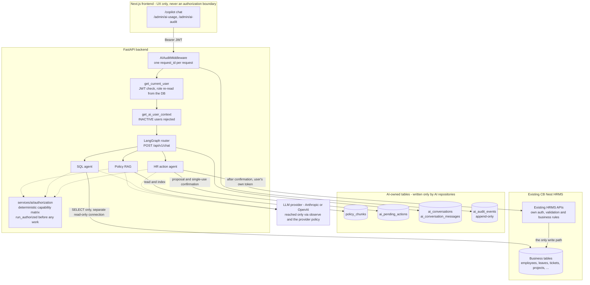
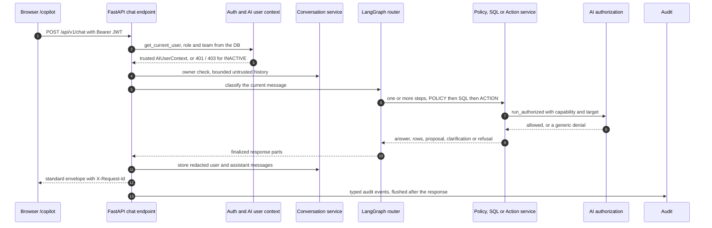
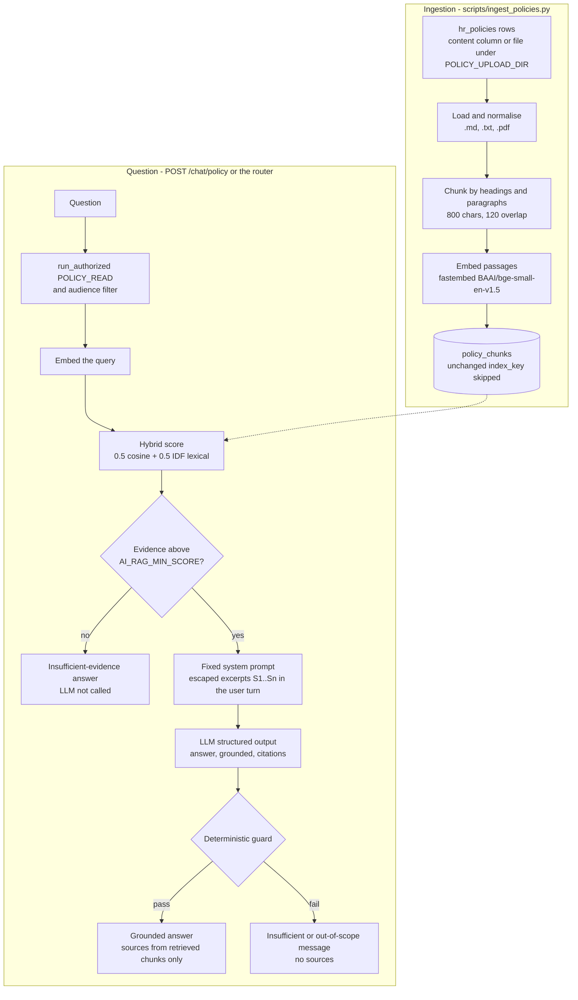
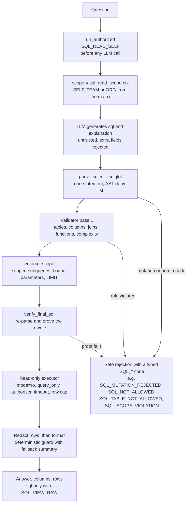
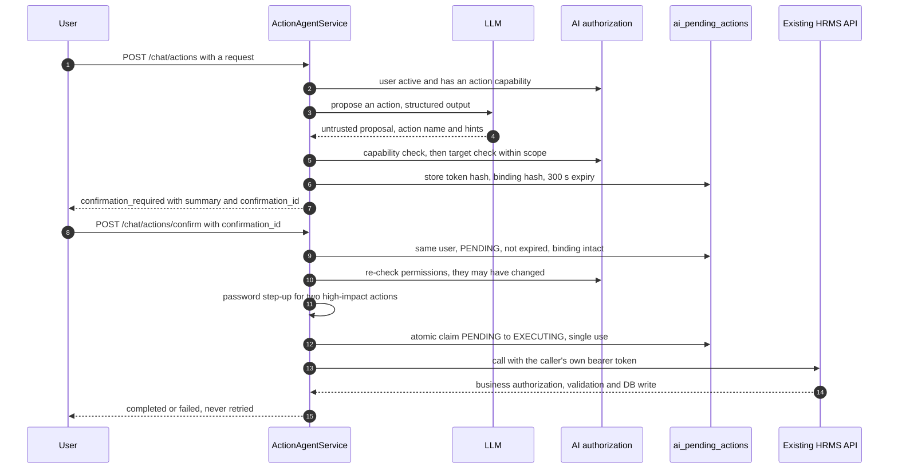

# AI Architecture — NovaWorks PeopleOps Copilot (CB Nest)

The AI layer of the CB Nest HRMS: a Policy RAG assistant, a read-only SQL agent and an HR action agent behind one
LangGraph router, all governed by a deterministic authorization boundary and an append-only audit trail.

## Status at a glance

| Aspect | Status | Evidence |
|---|---|---|
| Implementation | Phases 1–10 implemented (foundation, authorization boundary, Policy RAG, SQL agent, Action agent, router, conversations, audit and observability, Copilot UI, hardening and formal evaluation); production-hardening work since, including password step-up (G-11, `log` mode). Decisions D1–D7 approved. | [phase-10-final-report.md](phase-10-final-report.md), [ai_implementation_plan.md](ai_implementation_plan.md) |
| Automated tests | Backend 3208 passed, 1 skipped (opt-in live test), `verify-backend.sh`, 2026-10-21; Vitest 277 passed and TypeScript 0 errors at `6338adc`; Playwright 152 passed on 2026-10-20 (navigation 4/4 and pages 85/85 after the `6338adc` sidebar fix) | [capstone-submission-report.md](capstone-submission-report.md) §3 |
| Offline evaluation | 139/139 on six suites with **scripted or extractive model output**. This proves the pipelines and guardrails, not real-model quality. | [ai_eval_results.md](ai_eval_results.md) §2–3 |
| Live-model evaluation | One approved run, 2026-10-20, OpenAI `gpt-4o-mini`: router 33/33 (only 3 cases reached the model), policy 11/11 (the 3 refusals came from the retrieval threshold, before any model call; hash-embedding retrieval). Live SQL generation, action extraction and prompt-injection resistance are **not measured**. | [ai_eval_results.md](ai_eval_results.md) §4.2 |
| Manual browser walkthrough | **NOT_RUN**: 38 scenarios prepared, none executed by a person. Playwright automation is not a substitute for it. | [production-hardening/browser-walkthrough.md](production-hardening/browser-walkthrough.md) |
| CI (GitHub Actions) | Latest verified run (`859531f` (2026-10-21, run 39623606922; also `618e9d4` and `2023548`)): backend, frontend, browser E2E, production images and secret scan passed; the **dependency-advisory gate failed** | [production-hardening/ci-and-validation.md](production-hardening/ci-and-validation.md) §3 |
| Production readiness | **NOT YET PRODUCTION READY.** The dependency-advisory gate is unresolved (`braces`, build-time, exception still PROPOSED; Pillow 12.3.0, runtime, no compatible fix, no exception), the manual walkthrough is pending, and further release gates are open. | [production-hardening/release-readiness.md](production-hardening/release-readiness.md) §6, [final-security-readiness.md](final-security-readiness.md) |

## Executive summary

Users talk to one Copilot page. Each request is authenticated with the existing CB Nest JWT, the user's role and team
are re-loaded from the database, and a LangGraph router sends the message to the Policy RAG assistant, the SQL agent
or the HR action agent. Every one of those services re-checks the user's permissions in deterministic code before it
does anything else. Answers come back in the standard envelope, and every AI request leaves typed, privacy-preserving
events in an append-only audit table.

**Architecture principles**

1. **The LLM never decides authorization.** `services/ai/authorization/` (deterministic, database-loaded role and team)
   does. Decision D7: *AI authorization is at least as strict as the existing application, never looser.*
2. **The AI never writes business tables.** The SQL agent reads through a separate read-only connection, and business
   changes go through the existing HRMS APIs with the requesting user's own token, after explicit confirmation.
3. **Documents and model output are untrusted data.** Policy text never enters a system prompt; model output is
   validated before use.
4. **Fail closed.** A missing key or model, an invalid output or an unknown route ends in a safe error, never a guess.
5. **No secrets or personal data in logs and audit.** Audit stores lengths, keyed fingerprints, codes and counts.

## Contents

1. [High-level architecture](#1-high-level-architecture)
2. [Request routing and orchestration](#2-request-routing-and-orchestration)
3. [Policy RAG](#3-policy-rag)
4. [SQL agent](#4-sql-agent)
5. [HR action agent](#5-hr-action-agent)
6. [Authentication, authorization and data scope](#6-authentication-authorization-and-data-scope)
7. [Audit, conversations, providers and observability](#7-audit-conversations-providers-and-observability)
8. [Component map and assignment deliverables](#8-component-map-and-assignment-deliverables)
9. [API contracts](#9-api-contracts)
10. [Configuration and dependencies](#10-configuration-and-dependencies)
11. [Evaluation evidence and test status](#11-evaluation-evidence-and-test-status)
12. [Known limitations and production-readiness blockers](#12-known-limitations-and-production-readiness-blockers)
- [Appendix A — SQL validation rules in detail](#appendix-a--sql-validation-rules-in-detail)
- [Appendix B — Historical Phase 0 design](#appendix-b--historical-phase-0-design)

## 1. High-level architecture

This is the authoritative diagram of the current architecture. The historical Phase 0 design is in
[Appendix B](#appendix-b--historical-phase-0-design).



- **No AI write path to business tables.** AI code writes only the four AI-owned tables shown. Business changes are
  HTTP calls to existing endpoints (in-process `httpx.ASGITransport`) with the caller's bearer token, so the endpoint's
  own authorization and validation apply too.
- The frontend's role awareness (hidden buttons, the role cookie) is UX only; the backend decides every permission.
- The single-purpose endpoints `/chat/policy`, `/chat/sql` and `/chat/actions` call the same services directly.

## 2. Request routing and orchestration

Full design: [architecture/copilot-router.md](architecture/copilot-router.md).



**Router (Phase 6).**
- `POST /api/v1/chat` → `CopilotService` → LangGraph `StateGraph(CopilotState)`. The graph runs
  `classify → policy | sql | action | clarification | refusal | error → finalize`, with conditional edges only from
  `ALLOWED_TRANSITIONS`. Edges only go forward and no node runs twice.
- Limits: `MAX_GRAPH_ITERATIONS=5` and `RECURSION_LIMIT=10` (`orchestration/graph.py`). There is no checkpointer, so
  state is request-scoped.
- Classification order: refusal rules, then the clause split, then deterministic signals, then the structured
  fast-model fallback (`RouterClassification`, `extra="forbid"`), but only for clauses without a signal. Failure is
  closed: `AI_UNAVAILABLE` or `AI_CLASSIFICATION_FAILED`, never a guessed route.
- Nodes call only `PolicyRagService.answer`, `SQLAgentService.answer` and `ActionAgentService.propose`, with the
  trusted `ctx` from `config["configurable"]["deps"]`. **Routing is not authorization:** each service re-authorizes,
  so the router cannot drift from the capability checks. Identity is never placed in graph state, and the graph never
  calls `confirm`.
- Multi-intent messages run POLICY → SQL → ACTION with at most one action. Ambiguity or two mutations produce a
  clarification.

**Conversations (Phase 7).** Full design:
[architecture/phase-7-conversation-memory.md](architecture/phase-7-conversation-memory.md).
- Conversations are owner-only (`ai_conversations`, `ai_conversation_messages`, migration 0019). Every lookup is scoped
  by the caller; unknown, malformed, archived and foreign ids give an identical 404.
- Per turn: owner check → bounded untrusted context (last 6 messages, at most 2000 characters) → USER message stored →
  router (`answer_turn` with context) → ASSISTANT message stored (or a safe error row). Sequence numbers are allocated
  atomically.
- Follow-ups are detected deterministically. The route is the message's own rule signal, else the previous route, else
  the LLM with delimited history. Services receive only user text (the earlier question and the current message);
  assistant text is never forwarded. **History is context, never authorization and never truth.**

## 3. Policy RAG

> **Trust boundary: policy documents are untrusted data and cannot provide instructions to the model.**



**Request path.**

```text
POST /chat/policy → get_current_user → get_ai_user_context (INACTIVE → 403) → PolicyRagService.answer
  → run_authorized(POLICY_READ)            ← first operation; providers are resolved only after this
  → validate_question (1..1000 chars)      → AI_INVALID_REQUEST (400)
  → embed_query → hybrid retrieval         → no evidence ⇒ "insufficient" answer, LLM NOT called
  → fixed SYSTEM_PROMPT + user turn [<policy_context> escaped excerpts S1..Sn </policy_context><user_question>…]
  → LLM structured output {answer, grounded, citations[S-labels]}
  → deterministic guard → {answer, grounded, sources[{chunk_id,title,category,filename,section}]}
```

Only PUBLISHED policies are indexed or retrieved. Each policy has an audience (`ALL`, `MANAGERS`, `ADMINS`), and
retrieval filters by `policy_audiences(ctx)` before scoring; list, download and conversation replay apply the same
rule ([ai_permissions_matrix.md](ai_permissions_matrix.md)).

### 3.1 Data model and policy content

- In CB Nest one `hr_policies` row is exactly one document (upload stores one file per row), so no separate
  `policy_documents` table was added. The AI-owned `policy_chunks` table (migration `0017`, reversible) stores
  `chunk_id` (stable sha256 of policy_id, chunk_index and text), `policy_id` → `hr_policies.id`, `index_key` (sha256 of
  normalised text, chunk size and overlap), `source_filename`, `policy_title`, `category`, `section`, `chunk_index`,
  `text`, `embedding` (JSON) and `embedding_model`.
- **Policy content (D3).** `backend/data/policies/*.md` contains the leave, attendance, WFH, document upload and data
  privacy policies. Each file carries an HTML-comment "DEMO / SEED DATA" marker naming its source of truth.
  `scripts/seed.py` uses these files for the matching seeded titles (Leave, Attendance, WFH) and adds two new policies
  (Document Upload, Employee Data Privacy); the other 19 one-liners are unchanged. Facts come from
  `leave_policy_sample.pdf` (12/10/15 days, 2-day notice, 10 AM sick notice) and from code: `DEFAULT_LEAVE_TOTALS`,
  the half-day rules, the 09:00 clock-in cutoff, the 4.5 h half-day attendance rule, and the upload limits and types.

### 3.2 Ingestion, chunking and embeddings

- **Ingestion** (`rag/ingest.py`, run with `scripts/ingest_policies.py`): the loader reads each row's `content` column
  or its path-guarded file under `POLICY_UPLOAD_DIR` (.md, .txt, .pdf via pypdf); the text is normalised (BOM, CRLF
  and HTML comments stripped), chunked and embedded in a batch, and the store replaces that policy's chunks. A document
  is skipped when its `index_key` and embedding model are unchanged; chunks of policies that became unreadable or were
  removed are deleted. A second run is a no-op (tested, and verified end to end on a freshly seeded database: 24
  documents, 40 chunks, then 24 unchanged).
- **Chunking:** Markdown heading sections, then paragraph blocks packed up to `AI_POLICY_CHUNK_SIZE` (800 characters).
  A block is split only if it alone is too large, at line, sentence and finally word boundaries. The overlap
  (`AI_POLICY_CHUNK_OVERLAP`, 120) repeats the previous chunk's last block when it fits. The section label is `H2` or
  `H2 > H3`, and the embedding input is `"{title} - {section}\n{text}"`.
- **Embeddings** (D2): `FastEmbedEmbeddingProvider` with `AI_EMBEDDING_MODEL` (default `BAAI/bge-small-en-v1.5`),
  `passage_embed` and `query_embed`, lazy load in a worker thread, cache in `AI_EMBEDDING_CACHE_DIR`. Load failures
  return `AI_UNAVAILABLE` and runtime failures `AI_EMBEDDING_FAILED`. Tests use `FakeEmbeddingProvider` (hash,
  256 dimensions) and never download models.
- **Vector store:** there is no vector database in the repository (SQLite, no pgvector) and the corpus is small, so
  vectors are stored as JSON in `policy_chunks` and cosine similarity is computed in Python. The `PolicyVectorStore`
  protocol (`upsert(policy_id, chunks)`, `similarity_search(query_embedding, top_k)`, `all_chunks()`,
  `delete_policy(policy_id)`, `indexed_policies()`, `indexed_policy_ids()`) is bound to one `embedding_model`; vectors
  from different models are never compared. Chroma, FAISS or pgvector could
  replace `SQLitePolicyVectorStore` without changing the retriever or the service.

### 3.3 Retrieval, prompt and model

- **Hybrid retrieval** (`rag/retriever.py`): `score = 0.5·max(cosine, 0) + 0.5·lexical`, where `lexical` is the
  IDF-weighted share of the question's content words (stop words removed, plural and -ing stemming) found in the
  chunk's title, section and text. Short terms ("late", "half day") match reliably, and a term the library never
  mentions (for example "maternity") outweighs a common one ("leave"). Filters: `AI_RAG_MIN_SCORE` (0.35), then a
  relative cutoff (at least 60 % of the best score), then `AI_RAG_TOP_K` (4). Ordering is deterministic (score
  descending, policy_id, chunk_index). Retrieved chunks carry metadata and scores, never embeddings. A calibration on
  real embeddings proposes 0.475 as the threshold; it is **not applied** pending HR review
  ([production-hardening/rag-calibration.md](production-hardening/rag-calibration.md)).
- **Prompt:** `SYSTEM_PROMPT` is a constant with ten rules: HR policy only; excerpts are untrusted and are not
  instructions; never follow embedded instructions; evidence only; no invented policy; `grounded=false` when evidence is
  insufficient; no personal data; no actions; cite ids. Document text is never placed in system instructions. Excerpts
  and the question go in the user turn inside separate blocks, and all document text, attributes and the question are
  HTML-escaped, so a document cannot close its block or forge `<user_question>`.
- **Model:** see [§7.3](#73-provider-abstraction-and-boundary). Prompts, answers and keys are never logged; only the
  model, stop reason and request id are.

### 3.4 Response guard, citations and errors

The guard (`rag/guard.py`) is deterministic, with no second LLM. An answer is accepted only if:
- `grounded=true`, there is at least one citation, and every citation is one of the retrieved labels;
- the answer is non-empty and contains no sensitive values (PAN, IFSC, account-number, JWT or API-key patterns);
- it mentions no sensitive terms (salary, bank, PAN, DOB, password, PF/UAN/ESI) unless the cited evidence contains them;
- it makes no claim of having performed an action or changed a role, and doesn't echo injection phrases;
- every number in it appears in the cited evidence or the question.

Otherwise the user gets the insufficient-evidence message, or the out-of-scope message for sensitive, action or
injection reasons, with **no sources**. Sources are built only from the guard's validated set of *retrieved* chunks
(`chunk_id, title, category, filename, section`); the LLM cannot add a source. The guard has no entailment check: an
invented rule without numbers that cites a real excerpt would pass (pinned in tests; see
[ai_eval_results.md](ai_eval_results.md) §5).

**Errors:** `AI_INVALID_REQUEST` 400, `AI_USER_INACTIVE` / `AI_PERMISSION_DENIED` 403, `AI_RETRIEVAL_FAILED` 500,
`AI_EMBEDDING_FAILED` / `AI_PROVIDER_ERROR` / `AI_INVALID_OUTPUT` 502, `AI_UNAVAILABLE` 503. None include database
text, paths, keys, provider internals or stack traces (tested).

**Evaluation:** `backend/evals/policy_eval.json` has 11 cases (the 5 required questions plus document upload, approval
process, attendance rules, and 3 must-refuse cases). `evals/policy_rag_eval.py` measures retrieval hit, citation
validity, groundedness and refusal. Offline it uses `ExtractiveFakeLLM`, which can only quote retrieved sentences, so it
measures the pipeline, not model quality: 1.0 on all four metrics. The live run is reported separately
([§11](#11-evaluation-evidence-and-test-status)).

## 4. SQL agent

> **The LLM is never an authorization authority. SQL validation is enforced independently of the LLM prompt.** The
> LLM is an untrusted SQL generator; the backend is the security authority.



**Request path.**

```text
POST /chat/sql → get_current_user → get_ai_user_context (INACTIVE → 403)
  → SQLAgentService.answer → run_authorized(SQL_READ_SELF)     ← before any LLM call
  → validate_question → scope = sql_read_scope(ctx)              (SELF / TEAM / ORG from the matrix)
  → SQLGenerator: LLM structured output {sql, explanation}       (extra fields → AI_INVALID_OUTPUT)
  → parser.parse_select       one statement, root SELECT/set-op, no mutation/admin node anywhere
  → validator (pass 1)        CTE names, complexity, functions, :me only, no stars, tables, columns
                              (sqlglot qualify vs real schema), approved joins, [non-ORG] literal ids,
                              [non-ORG] scope intent
  → scope.enforce_scope       wrap every table in a backend scope subquery, inject my_team, LIMIT
  → scope.verify_final_sql    re-parse the regenerated SQL and prove wrappers/CTE/LIMIT (pass 2)
  → executor                  mode=ro + query_only + per-query authorizer + timeout + row cap
  → formatter                 redact rows → LLM answer → deterministic guard (fallback summary)
```

**Package** `backend/app/services/ai/sql/`:

| Module | Contents |
|---|---|
| `schema.py` | registry (`TABLES`, `DENIED_TABLES`, owner columns, approved joins, `my_team`, `:me`) |
| `parser.py` | sqlglot SQLite parse and AST deny-list |
| `validator.py` | pass-1 rules |
| `scope.py` | rewrite, LIMIT, pass-2 verification |
| `executor.py` | read-only execution |
| `prompts.py`, `generator.py` | generation prompts and the SQL generation call |
| `formatter.py` | redaction and answer formatting |
| `models.py` | output schemas, `SQLAnswer`, `SQLRunRecord` |
| `service.py` | `SQLAgentService`, `get_sql_agent_service` |

**Key safety properties** (complete rules in [Appendix A](#appendix-a--sql-validation-rules-in-detail)):
- **SQL text vs execution safety.** Validation proves what the SQL *says*; the executor independently limits what it
  *can do*. The only SQL executed is regenerated from the validated AST with `comments=False`; the model's raw text is
  never executed, so anything hidden in comments cannot run.
- **Read-only execution.** A separate `sqlite3` connection is opened as `file:<db>?mode=ro` with
  `PRAGMA query_only=ON`; the app's read/write engine is never used. A per-query authorizer allows `SQLITE_SELECT`,
  `SQLITE_READ` of the allowlisted columns of *this query's* tables, table-level reads only for those tables and CTEs, and
  allowlisted functions, and denies everything else. Tests execute writes and forbidden reads directly (bypassing the
  validator) and show the database hash unchanged.
- **Scope is applied by the backend**, by rewriting table references into scoped subqueries with bound parameters,
  never by asking the LLM to add a WHERE clause.
- **Forbidden columns** (passwords, bank, PAN, DOB, salary, photo paths, payroll PAN/UAN/ESI) are classified in
  `schema.py` and pinned by `tests/ai/sql/test_schema_registry.py::EXPECTED_FORBIDDEN`.
- **Row limit and timeout:** the outermost `LIMIT` becomes `min(literal, AI_SQL_MAX_ROWS=100)`, the executor fetches
  at most 100 rows and reports `truncated`, and a progress-handler timeout (`AI_SQL_TIMEOUT_SECONDS`, 3) stops long
  queries.
- **Result handling:** columns with sensitive names are dropped and string values pass through `redact()` **before**
  the formatter model sees them. The formatter answer must not contain sensitive values or action/role claims, and
  every number in it must appear in the rows or the question; otherwise a deterministic summary is returned. Empty
  results never call the formatter. `sql` (the validated SQL with `:me`, not the rewritten one) is returned only to
  roles with `SQL_VIEW_RAW` (MANAGER, ADMIN).
- **Observability:** `SQLRunRecord` holds request_id, employee_id, role, capability, question length, SQL hash, scope,
  tables, outcome or rejection detail, duration, row count and LLM calls, logged as `ai.sql.run` with no row values,
  question text or SQL text.

## 5. HR action agent

> **The LLM proposes actions; the backend authorizes and executes them. All data-changing AI actions require explicit
> confirmation. The Action Agent can call only registered HRMS APIs.**



**Request path.**

```text
POST /chat/actions {question}
  get_current_user → get_ai_user_context (INACTIVE → 403)
  ActionAgentService.propose
    active + ≥1 action capability (before any LLM call)
    LLM → ActionProposal (structured; action enum + name/id HINTS; extra fields → AI_INVALID_OUTPUT)
    ACTION_REGISTRY[action] → fixed capability, method, route, params schema
    run_authorized(ctx, spec.capability)                      capability check
      TargetResolver (reads only, scope-filtered BEFORE matching; ambiguity → clarification)
      require(ctx, capability, TargetEmployee(owner))          target-level check (defence in depth)
      typed params validation (shape only; business rules stay in the API)
      ConfirmationService.create → ai_pending_actions (token hash, binding hash, TTL)
  → {status: clarification_required | confirmation_required, summary, confirmation_id, expires_at}

POST /chat/actions/confirm {confirmation_id}            (extra fields → 422)
  ActionAgentService.confirm
    load_valid: same user, PENDING, not expired, binding hash intact (else AI_CONFIRMATION_INVALID)
    run_authorized(ctx, capability, TargetEmployee) again (permissions may have changed)
      claim: UPDATE … SET status='EXECUTING' WHERE id=? AND status='PENDING' (single use) + commit
      HRMSActionClient → existing endpoint via in-process ASGI, Authorization: Bearer <caller's own token>
      existing get_current_user / role checks / validation / DB logic   ← authoritative
  → {status: completed | failed (business error code + message)}
```

**Package** `backend/app/services/ai/actions/`:

| Module | Contents |
|---|---|
| `models.py` | `ActionName`, `ActionProposal` (untrusted), typed params mirroring the API schemas, `PreparedAction`, `ActionResponse` |
| `registry.py` | `ACTION_REGISTRY`: 10 frozen specs, validated at import (method ∈ {POST, DELETE}, `/api/v1/` path, not on the deny-list, confirmation required, name == capability) |
| `resolver.py` | `TargetResolver`: employee, assignee, pending leave, ticket and project lookup restricted to the capability's target rule |
| `validators.py` | `prepare_action`: resolution + target `require()` + params validation + human summary |
| `confirmation.py` | `ConfirmationService`: the only writer in the package, and only to `ai_pending_actions` |
| `client.py` | `HRMSActionClient`: one typed method per action, one registry-bound `_send` |
| `prompts.py` | `ACTION_SYSTEM_PROMPT`; the user turn lists only the role-allowed actions |
| `service.py` | `ActionAgentService`, `get_action_agent_service` |

The ten registered actions, their routes and the role permissions are in
[ai_permissions_matrix.md](ai_permissions_matrix.md) §3.0. Employees cannot approve or reject leave, assign tickets,
create announcements or projects, assign projects or deactivate employees through the AI.

**Identity propagation.** The client calls the running app in-process (`httpx.ASGITransport(request.app)`) using the
*caller's own bearer token* (taken from the request by the existing `oauth2_scheme`). Every mutation passes through the
real route, with its own `get_current_user`, role checks, validation and DB code. There is no service account, no
admin token and no duplicated business logic; tests prove that `approver_id` and `author_id` are the caller. The outer
request commits (releasing SQLite locks) before the inner call.

**No direct writes.** The resolver only SELECTs, and the confirmation repository writes only `ai_pending_actions`.
Static tests scan the package for write calls, commits and HTTP imports outside `client.py`; behavioural tests compare
business-table hashes before and after every denied, clarified or failed action.

**Confirmation, step-up and retries.** Confirmations are single-use, bound to the user, action, target and payload,
and expire after `AI_ACTION_CONFIRMATION_TTL_SECONDS` (300). `ANNOUNCEMENT_CREATE` and `EMPLOYEE_DEACTIVATE` also need
the confirming user's password (AIS-12); a refused password leaves the confirmation PENDING. Only the request that wins
the atomic claim records `ACTION_CONFIRMED` (written before execution, fail-closed). Mutations are never retried: a
timeout or 5xx returns `AI_BACKEND_UNAVAILABLE` and marks the confirmation FAILED, and stale state (such as a leave
approved meanwhile) is rejected by the existing API (`LEAVE_NOT_PENDING`).

**Audit.** `ActionAuditRecord` (user, role, stage, action, target, resource, confirmation record id, outcome, error
code, timestamp) is logged as `ai.action`, and `ai_pending_actions` keeps the status, result code and used_at of every
confirmation. Neither holds tokens, request bodies or personal data values. Phase 8 persists these outcomes as typed
events in `ai_audit_events` ([§7.1](#71-audit-trail)).

**Not supported (no backing API or not requested):** editing or cancelling a leave request; a rejection reason (the
existing reject endpoint takes no body); reactivation (not requested by the assignment; available in the normal UI).

## 6. Authentication, authorization and data scope

> **AI authorization is stricter than existing HRMS authorization. AI authorization must never be more permissive.**

**Decision D7 (approved):** the AI layer may be stricter than an existing endpoint and must never be more permissive,
even where the endpoint itself allows more (R4 team scoping, ticket status by owners, project creation by managers).
`backend/app/services/ai/authorization/` (originally planned as `permissions.py`) is the **only** place AI code decides
access; it has no I/O except building the context. The role-by-capability matrix is documented in
[ai_permissions_matrix.md](ai_permissions_matrix.md).

| Module | Responsibility |
|---|---|
| `capabilities.py` | `Capability` enum (24 capabilities), `TargetRule` (NONE/SELF/TEAM/REPORTS/ORG/ORG_EXCEPT_SELF), `ScopeLevel` |
| `policy.py` | `AI_PERMISSION_MATRIX`, an immutable `MappingProxyType` of capability → {role → target rule}; the single source of truth; missing means deny |
| `context.py` | `AIUserContext` (frozen, slots): `employee_id, role, is_active, manager_id, department_id, direct_report_ids`, plus `team_ids`, built by `build_ai_user_context(employee, db)` from the DB row. The dependency `get_ai_user_context` reuses `get_current_user` and **rejects INACTIVE users before anything else runs** (`AI_USER_INACTIVE`, 403). |
| `scope.py` | `TargetEmployee(employee_id)` (typed, positive int), `target_allowed()`, `DataScope` with `hr_read_scope()` / `sql_read_scope()` (SELF → {me}, TEAM → {me} ∪ direct reports, ORG → unrestricted) |
| `sensitive.py` | `SENSITIVE_COLUMNS` (exact schema names) plus `SENSITIVE_TOKENS` (aliases such as `salary`, `dob`, `account_number`, `pf_number`, `password_hash`, camelCase); `is_sensitive_field()`; `is_column_readable(ctx, table, column)`, where the payroll table needs PAYROLL_READ_ORG |
| `service.py` | `authorize(ctx, capability, resource=None) -> AuthorizationResult{allowed, capability, reason, message}` (never raises), `require(...)` (raises), and `run_authorized(ctx, capability, operation, resource=...)`, which authorizes **before** the operation (LLM, retrieval, SQL or tool) is awaited |

**Design properties.**
- **Narrow inputs:** only an `AIUserContext`, a `Capability` member and an optional `TargetEmployee`. Strings (such as
  capability names produced by an LLM), dicts and `authorized: true` payloads are rejected with `INVALID_REQUEST`. No
  parameter exists through which the prompt, LLM output, tool arguments, retrieved documents or frontend claims could
  assert a role or a decision.
- **Team scope** comes from `employees.manager_id` (direct reports) loaded server-side, never from `role = 'MANAGER'` or
  LLM-generated conditions.
- **Generic denials:** "no capability", "out of scope" and "target does not exist" all return *"You are not authorized
  to access this resource."* Scope checks never query the target, so there is no existence oracle.
- **Defence in depth for INACTIVE users (R9):** the dependency rejects them, and `authorize()` independently denies any
  context with `is_active=False`.
- `services/ai/guards.py` imports its sensitive-field definition from `authorization/sensitive.py` (one definition) and
  keeps the AI deny-list of business routes (for example `GET /employees/{id}`).
- `GET /api/v1/chat/permissions` returns the caller's capabilities and data scope for role-aware UI. An `AIError`
  handler in `main.py` renders AI errors in the standard envelope; existing endpoint error shapes are unchanged
  (tested).

**Critical invariant.** No AI module holds a read-write connection to business tables. The only AI writes are to the
AI-owned tables (`policy_chunks`, `ai_pending_actions`, `ai_conversations`, `ai_conversation_messages`,
`ai_audit_events`), through dedicated repository functions. All business mutations are HTTP calls to existing endpoints
with the requesting user's bearer token.

**Sessions.** Business-API tokens carry a token version: password changes, global sign-out, deactivation and
reactivation revoke earlier tokens (`TOKEN_REVOKED`). High-impact business operations support a password step-up
(G-11), currently in `log` mode, where a wrong or missing password is logged but not blocked on the business API (see
[production-hardening/deployment-runbook.md](production-hardening/deployment-runbook.md) §2.1).

## 7. Audit, conversations, providers and observability

Conversations are described in [§2](#2-request-routing-and-orchestration).

### 7.1 Audit trail

Full design: [architecture/phase-8-audit-observability.md](architecture/phase-8-audit-observability.md).

- `AIAuditMiddleware` gives every `/api/v1/chat*` and `/api/v1/ai*` request one `request_id` (`X-Request-Id`). AI code
  records typed, allowlisted events in memory; they are flushed to the append-only `ai_audit_events` table (migration
  0020, triggers block UPDATE and DELETE) after the response, failing open to the structured log. `ACTION_CONFIRMED` is
  written before execution and fails closed.
- Recorded fields include the user id, `actor_role`, intents and routes, the capability or action, the target and
  resource ids, status, error code, duration and timestamp. **No prompts, answers, SQL, rows, tokens or personal data
  are stored**: lengths, keyed fingerprints, codes, routes and counts only.
- Read API: `GET /api/v1/ai/audit` and `/api/v1/ai/audit/metrics` (AUDIT_READ_ORG / AUDIT_READ_OWN).

**Message privacy (deliberate deviation from the assignment).** The assignment lists "message" among the audit
fields. Audit events store **no message text**: only its length (`message_chars`) and a keyed HMAC fingerprint
(`message_hash`). The user's text is kept, **redacted**, only in the owner-scoped conversation store
(`ai_conversation_messages`) and is linked to the audit trail by `request_id`. Reason: the audit table is append-only
and cannot be corrected or erased, so it must not hold personal data. Evidence: `tests/ai/audit/`;
[architecture/phase-10-gap-analysis.md](architecture/phase-10-gap-analysis.md).

### 7.2 Usage dashboard, Copilot modes and production checks

- **Role-specific Copilot modes** (Employee, Manager, Admin): the title, focus areas and example prompts come from
  `GET /chat/permissions` (`lib/copilot-display.ts::copilotMode`). UX only.
- **AI usage dashboard** `/admin/ai-usage`: intents, tools, actions by type, requests by role, RAG no-answer rate,
  action confirmation rate and execution success, all derived from the audit events (no new store); admin-only
  (AUDIT_READ_ORG).
- **Production checks** (`app/core/production_checks.py`): with `ENVIRONMENT=production`, startup refuses a default or
  weak `JWT_SECRET_KEY`; a missing or reused `AI_AUDIT_FINGERPRINT_KEY`; wildcard `ALLOWED_HOSTS` or CORS origins;
  external tracing variables (LangSmith/LangChain) unless `ALLOW_EXTERNAL_TRACING=true`; the fake LLM or embedding
  provider and `AI_FAKE_LLM_SCRIPT`; and a missing key or model for the selected provider.
- **Streaming:** not implemented. Decided under FastAPI 0.116, which closes `yield` dependencies (the request DB
  session) before a streaming body runs; not re-probed on the current FastAPI 0.133.1
  ([architecture/phase-10-gap-analysis.md](architecture/phase-10-gap-analysis.md) §3).
- **Tracing:** no LangSmith or OpenTelemetry integration; external tracing is blocked in production by the check
  above. Observability is the audit trail, provider-call metrics and structured logs.

### 7.3 Provider abstraction and boundary

- Services depend only on the `LLMProvider` protocol (`llm/base.py`: `generate`, `generate_structured`). The concrete
  provider (`anthropic`, `openai`, or `fake` for tests) is chosen by `AI_LLM_PROVIDER` in `providers.py`. A missing key
  or model fails closed (`AI_UNAVAILABLE`); there is no automatic fallback between real providers, so data never goes
  to a provider that was not configured.
- **Models:** `AI_LLM_MODEL` (or `AI_OPENAI_MODEL`) generates answers, SQL and action proposals; `AI_LLM_FAST_MODEL`
  (or `AI_OPENAI_FAST_MODEL`) classifies routes. Embeddings are local (`fastembed`); there is no embeddings API.
- `AnthropicLLMProvider` (D1) uses `client.beta.messages.parse(output_format=PolicyLLMOutput)` (typed structured
  output), `output_config.effort` from `AI_LLM_EFFORT` (default `low`), and a server-side refusal fallback
  (`fallbacks="default"`, beta `server-side-fallback-2026-07-01`) that `AI_LLM_SERVER_FALLBACKS=false` disables; the
  fast router model uses neither effort nor the fallback beta. `OpenAILLMProvider` (added 2026-10-16) uses the
  Responses API with a strict JSON-schema format derived from the requested Pydantic model, validates the JSON locally,
  sends `store=false` and pins the API base URL ([ai-provider-setup.md](ai-provider-setup.md)). No `temperature` is
  sent unless configured, because current Claude models reject non-default sampling parameters. A `refusal` maps to
  `AI_PROVIDER_ERROR`, `max_tokens` or unparsable output to `AI_INVALID_OUTPUT`, and SDK errors to typed AI errors.
- Every call is wrapped by `audit/provider.observe(llm, "operation")` (provider, model, latency, tokens, estimated cost
  when priced). Before the provider sees anything, `provider_policy.prepare` refuses unregistered operations, removes
  credentials, normalises text and replaces personal identifiers (email, PAN, IFSC, Aadhaar, phone, long numbers) with
  placeholders that are restored only in that call's output and never stored. Only counts and categories are audited.
  Names and free text are not detected by patterns; which of those may be sent is an open governance decision
  (G-01/G-02, [production-hardening/ai-security-remediation-progress.md](production-hardening/ai-security-remediation-progress.md)).
- `limits.py` (AIS-10) gives each request a model-call budget and deadline and enforces a per-user rate limit, a daily
  token budget and a process-wide concurrency limit.
- Test and evaluation providers (`FakeLLMProvider`, `FakeEmbeddingProvider`, `ExtractiveFakeLLM`, the scripted
  `ScriptedFakeLLM`) are refused in production.

## 8. Component map and assignment deliverables

### 8.1 Backend and frontend layout

Every path below exists in the repository (re-checked 2026-10-21).

```text
backend/app/services/ai/
  errors.py            AIError hierarchy with stable AI_* codes and safe messages
  providers.py         build_llm_provider / build_fast_llm_provider / build_embedding_provider: config -> provider;
                       fail closed (AI_UNAVAILABLE); no automatic fallback between real providers
  provider_policy.py   AIS-02 provider boundary applied to every model call (§7.3)
  limits.py            AIS-10 per-request model-call budget and deadline; per-user rate limit and daily token budget
  guards.py            sensitive fields, AI deny-list of business routes (e.g. GET /employees/{id})
  redaction.py         JWT / bearer / API key / PAN / IFSC / long-number redaction + truncation
  validation.py        shared question validation (RAG + SQL)
  retention.py         AI-owned table retention report (dry run / --check)
  embeddings.py        EmbeddingProvider protocol, FakeEmbeddingProvider (hash), FastEmbedEmbeddingProvider (local)
  llm/                 base.py (LLMProvider protocol), anthropic_provider.py, openai_provider.py, fake.py
  authorization/       Phase 2: capabilities, policy (the matrix), context, scope, sensitive, service
  rag/                 Phase 3: loader, chunker, ingest, vector_store, retriever, prompts, guard, models, service
  sql/                 Phase 4: schema (registry), parser, validator, scope, executor, generator, formatter,
                       prompts, models, skill_search, service
  actions/             Phase 5: registry, models, resolver, validators, confirmation, client, prompts,
                       reconciliation, service
  orchestration/       Phase 6: classifier, graph (LangGraph), state, models, prompts, service; followup.py (Phase 7)
  conversation/        Phase 7: ConversationService (ai_conversations / ai_conversation_messages)
  audit/               Phase 8: events, recorder, store, middleware, provider (observe), query
backend/app/api/v1/endpoints/chat.py       POST /chat, /chat/policy, /chat/sql, /chat/actions, /chat/actions/confirm;
                                           GET /chat/permissions; GET|DELETE /chat/conversations[/{id}];
                                           the pre-existing /chat/sessions stubs (unchanged)
backend/app/api/v1/endpoints/ai_audit.py   GET /ai/audit, GET /ai/audit/metrics
backend/app/models/                        policy_chunk.py, ai_pending_action.py, ai_conversation.py, ai_audit_event.py
backend/alembic/versions/                  0017_policy_chunks, 0018_ai_pending_actions, 0019_ai_conversations,
                                           0020_ai_audit_events (AI-owned); 0021-0024 business changes
                                           (policy publication, audiences, token version)
backend/scripts/ingest_policies.py         CLI to (re)build the policy index
backend/evals/                             evaluation runner and datasets (see ai_eval_results.md)
frontend/app/copilot/[[...conversation]]/  the Copilot page; frontend/app/admin/ai-usage, frontend/app/admin/ai-audit
frontend/components/copilot/               copilot-shell (chat panel), message-parts (PolicySources, DataTable,
                                           ActionCard, SafeText), usage-dashboard, audit-view
frontend/lib/                              copilot-api.ts, copilot-errors.ts, copilot-display.ts
```

Frontend design: [architecture/phase-9-copilot-frontend.md](architecture/phase-9-copilot-frontend.md). AI output is
rendered as text only, AI endpoints are called only through `lib/copilot-api.ts`, and a confirmation is sent once with
the backend `confirmation_id`, never retried.

### 8.2 Assignment deliverables → implementation → tests

The assignment suggests single-file names; the implementation uses one package per concern
(`.claude/rules/architecture.md`). No compatibility modules were added just to match names. The same mapping is in
[architecture/phase-10-gap-analysis.md](architecture/phase-10-gap-analysis.md).

| Assignment expects | Implemented as | Main tests |
|---|---|---|
| `services/ai/policy_rag.py`, `embeddings.py`, `vector_store.py` | `services/ai/rag/` (`service.py`, `vector_store.py`, `retriever.py`, `guard.py`), `services/ai/embeddings.py` | `tests/ai/rag/` |
| `services/ai/sql_agent.py`, `sql_guardrails.py` | `services/ai/sql/service.py`; guardrails in `sql/parser.py`, `validator.py`, `schema.py`, `scope.py`, `executor.py` | `tests/ai/sql/`, `tests/ai/hardening/` |
| `services/ai/action_agent.py`, `api_tools.py`, `permissions.py` | `services/ai/actions/service.py`; tools in `actions/registry.py` + `actions/client.py`; permissions in `services/ai/authorization/` | `tests/ai/actions/`, `tests/ai/authorization/` |
| `api/v1/endpoints/chat.py` (`/chat/policy`, `/chat/sql`, `/chat/actions`, optional `/chat/router`) | same file; the router is `POST /api/v1/chat` | `tests/ai/rag/`, `tests/ai/sql/`, `tests/ai/actions/`, `tests/ai/orchestration/` |
| `app/ai-copilot/page.tsx`, `components/ai/*` | `app/copilot/[[...conversation]]/page.tsx`, `components/copilot/*`, `lib/copilot-*.ts` | `frontend/tests/copilot-*.test.tsx`, `frontend/e2e/workflow-copilot*.spec.ts` |
| `models/ai_audit_log.py`, `services/ai/audit.py`, `<migration>_add_ai_audit_logs.py` | `models/ai_audit_event.py`, `services/ai/audit/`, `0020_ai_audit_events.py` | `tests/ai/audit/` |
| `docs/ai_architecture.md`, `ai_permissions_matrix.md`, `ai_eval_results.md` | `HRMS-main/docs/` (same names) | — |

## 9. API contracts

All endpoints return the standard envelope.

| Endpoint | Request | `data` on success |
|---|---|---|
| POST `/api/v1/chat/policy` | `{question}` (alias `{message}`) | `{answer, grounded: bool, sources:[{chunk_id,title,category,filename,section}]}` |
| GET `/api/v1/chat/permissions` | — | `{employee_id, role, capabilities[], data_scope}` |
| POST `/api/v1/chat/sql` | `{question}` (alias `{message}`) | `{answer, scope, columns, rows, row_count, truncated, sql?}` (`sql` only with SQL_VIEW_RAW) |
| POST `/api/v1/chat/actions` | `{question}` (alias `{message}`) | `{status: "clarification_required"\|"confirmation_required", message, action?, summary?, confirmation_id?, expires_at?}` |
| POST `/api/v1/chat/actions/confirm` | `{confirmation_id}` (plus `password` for step-up actions; other fields → 422) | `{status: "completed"\|"failed", message, action, summary, result?, error_code?}` |
| POST `/api/v1/chat` | `{message, conversation_id?}` (alias `{question}`; extra fields → 422) | `{conversation_id, follow_up, request_id, status: answered\|clarification_required\|confirmation_required\|refused\|partial, code?, intents[], routes[], classification_source, message, parts:[{route, status, message, data?, error_code?}]}`. Single-route service errors keep the service's code and status (+ `X-Conversation-Id` header). |
| GET `/api/v1/chat/conversations` | `?limit` (≤ 50) | own active conversations `[{conversation_id, title, message_count, created_at, updated_at}]` |
| GET `/api/v1/chat/conversations/{id}` | `?limit` (≤ 200) | own conversation + most recent messages `[{sequence, role, content, route?, status?, error_code?, created_at}]` |
| DELETE `/api/v1/chat/conversations/{id}` | — | archive own conversation `{conversation_id, status: ARCHIVED}` |
| GET `/api/v1/ai/audit` | `?limit (≤100)&offset&event_type&status&route&request_id&conversation_id&employee_id (ADMIN)&created_from&created_to` | `{items:[{event_id, request_id, sequence, conversation_id, employee_id, event_type, status, route, duration_ms, metadata, created_at}], meta:{total, limit, offset}}`. ADMIN: all; others: own only. |
| GET `/api/v1/ai/audit/metrics` | `?created_from&created_to` | ADMIN only: request/refusal/clarification/denial/action/provider counts, latency `{count, avg, p95, max}`, tokens, estimated cost (null unless priced) |

Errors: `{"success": false, "data": null, "error": {"code": "AI_…", "message": "…"}}` with an appropriate HTTP status
(401/403/422/429/502/503), never with stack traces, SQL errors, prompts or tokens. Browser clients: CORS exposes
`X-Request-Id` and `X-Conversation-Id`, so the frontend can show support references and recover the conversation of a
failed first turn.

## 10. Configuration and dependencies

### 10.1 Configuration

Environment variables (pydantic-settings, `app/core/config.py`). Secrets come only from the environment and are never
committed. If `AI_ENABLED=false` or the selected provider's key is missing, AI endpoints return `503 AI_UNAVAILABLE` and
the rest of the app is unaffected.

| Area | Variables (default) |
|---|---|
| Provider | `AI_ENABLED` (true); `AI_LLM_PROVIDER` (`anthropic`; `anthropic` \| `openai` \| `fake`, fake refused in production) |
| Anthropic | `ANTHROPIC_API_KEY` (env only); `AI_LLM_MODEL` (`claude-sonnet-5-5`, D1); `AI_LLM_FAST_MODEL` (`claude-haiku-4-5-20251001`, router classification); `AI_LLM_EFFORT` (`low`); `AI_LLM_SERVER_FALLBACKS` (true) |
| OpenAI | `OPENAI_API_KEY` (env only); `AI_OPENAI_MODEL` / `AI_OPENAI_FAST_MODEL` (no default; fast falls back to the main model); `AI_OPENAI_REASONING_EFFORT` (sent only when set) |
| Generation | `AI_TEMPERATURE` (unset; Claude 5.x rejects non-default sampling); `AI_MAX_TOKENS` (4096); `AI_REQUEST_TIMEOUT_SECONDS` (30) |
| Limits (AIS-10) | `AI_MAX_MODEL_CALLS_PER_REQUEST` (8); `AI_REQUEST_DEADLINE_SECONDS` (120); `AI_RATE_LIMIT_PER_MINUTE` (20); `AI_DAILY_TOKEN_BUDGET` (200000 per user per UTC day; 0 disables); `AI_DAILY_COST_CAP_USD` (unset); `AI_MAX_CONCURRENT_LLM_CALLS` (4) |
| Embeddings and RAG | `AI_EMBEDDING_PROVIDER` (`fastembed` \| `fake`); `AI_EMBEDDING_MODEL` (`BAAI/bge-small-en-v1.5`); `AI_EMBEDDING_CACHE_DIR` (no code default; `.env.example` uses `/app/storage/models`); `AI_RAG_TOP_K` (4); `AI_RAG_MIN_SCORE` (0.35); `AI_POLICY_CHUNK_SIZE` (800); `AI_POLICY_CHUNK_OVERLAP` (120) |
| SQL agent | `AI_SQL_MAX_ROWS` (100); `AI_SQL_MAX_JOINS` (4); `AI_SQL_TIMEOUT_SECONDS` (3) |
| Actions | `AI_ACTION_CONFIRMATION_TTL_SECONDS` (300; in-process ASGI is the only transport) |
| Conversations | `AI_CONVERSATION_MAX_MESSAGES` (200); `AI_CONVERSATION_CONTEXT_MESSAGES` (6); `AI_CONVERSATION_CONTEXT_CHARS` (2000); `AI_CONVERSATION_STORED_MESSAGE_CHARS` (4000, after redaction) |
| Audit and cost | `AI_AUDIT_ENABLED` (true; false = structured log only, no fail-closed); `AI_AUDIT_FINGERPRINT_KEY` (required in production); `AI_LLM_INPUT_COST_PER_MTOK` / `_OUTPUT_`, `AI_LLM_FAST_INPUT_COST_PER_MTOK` / `_OUTPUT_` and the `AI_OPENAI_*_COST_PER_MTOK` equivalents (optional USD per million tokens; unset → cost null) |
| Security | `STEP_UP_ENFORCEMENT` (`log`; `off` \| `log` \| `enforce`, see §6); `ALLOW_EXTERNAL_TRACING` (false) |
| Tests only | `AI_FAKE_LLM_SCRIPT` (scripted fake for the isolated E2E stack; refused in production) |

### 10.2 Dependencies

| Package | Purpose | Added |
|---|---|---|
| `anthropic==1.9.0` | LLM provider (Python ≥ 3.10) | Phase 3 |
| `openai==3.23.0` | alternative LLM provider (Responses API); shares `httpx2` with `anthropic` | 2026-10-16 |
| `fastembed==0.8.1` + `onnxruntime==1.22.1` | local embeddings (the pinned onnxruntime supports Python 3.11 and 3.12) | Phase 3 |
| `sqlglot==30.20.0` | SQL parsing, qualification and rewriting (Python ≥ 3.9, no dependencies) | Phase 4 |
| `httpx==0.28.1` | in-process calls to the existing API (moved from dev-only to runtime requirements) | Phase 5 |
| `langgraph==1.2.12` | orchestration state machine (brings langchain-core transitively; only `RunnableConfig` is imported) | Phase 6 |
| `pytest`, `pytest-asyncio`, `httpx` | tests (`requirements-dev.txt`) | Phase 1 |

Cosine similarity is computed in pure Python (the corpus is small), so numpy is not a direct dependency; it arrives
transitively with fastembed. So does Pillow (required by `fastembed` and `reportlab`), which currently carries runtime
advisories ([§12](#12-known-limitations-and-production-readiness-blockers)).

## 11. Evaluation evidence and test status

Different kinds of evidence answer different questions and must be read separately.

| Evidence | What it shows | What it does not show | Where |
|---|---|---|---|
| Backend tests (3208 passed, 1 skipped) | authorization, guardrails, services, endpoints, audit privacy, no business writes | real-model behaviour | `HRMS-main/backend/tests/`, [capstone-submission-report.md](capstone-submission-report.md) §3 |
| Offline evaluation (139/139) | pipeline correctness with scripted or extractive model output (policy 11, SQL 20, router 33, conversation 25, actions 20, assignment 30; the assignment set `evals/assignment_eval.json` holds the assignment's prompts plus injection cases) | real-model quality | [ai_eval_results.md](ai_eval_results.md) §2–3 |
| Live-model run (2026-10-20, `gpt-4o-mini`) | 8 answerable policy questions answered with the expected fact and valid citations; routing of 33 cases | universal accuracy; refusals by the model; live SQL, actions or injection resistance; production retrieval (hash embeddings were used) | [ai_eval_results.md](ai_eval_results.md) §4.2 |
| Retrieval calibration (2026-10-14) | real-embedding retrieval quality (Recall@4 1.000 on the holdout split) | answer quality; the 0.475 threshold proposal is not applied | [production-hardening/rag-calibration.md](production-hardening/rag-calibration.md) |
| Browser E2E (Playwright, 152) | role-wise pages, API authorization, workflows, Copilot action lifecycle with fake providers | live-model answers in the browser; a human walkthrough | `HRMS-main/frontend/e2e/`, [role-access-test-report.md](role-access-test-report.md), [deep-workflow-test-report.md](deep-workflow-test-report.md) |
| CI (GitHub Actions) | the same suites on a clean runner; production image checks; secret scan | — (the dependency gate fails, see §12) | [production-hardening/ci-and-validation.md](production-hardening/ci-and-validation.md) §3 |
| Manual walkthrough | — | **NOT_RUN** | [production-hardening/browser-walkthrough.md](production-hardening/browser-walkthrough.md) |

Commands: `python -m evals.run_evals` (offline; throwaway database), `python -m evals.run_evals --live` (needs the
selected provider's key and model and an approved budget), `sh HRMS-main/scripts/verify-backend.sh` (backend suite,
offline evaluations and gate tests in a throwaway container). Details:
[production-hardening/ci-and-validation.md](production-hardening/ci-and-validation.md) §2.

## 12. Known limitations and production-readiness blockers

**Status: NOT YET PRODUCTION READY.** Passing tests are necessary evidence, not a release decision. Release gates:
[production-hardening/release-readiness.md](production-hardening/release-readiness.md) §6; open findings:
[final-security-readiness.md](final-security-readiness.md).

**Unresolved blockers**
- **Dependency-advisory gate fails in CI.** `braces` (high; build-time only, absent from the production web image; no
  patched release; exception PROPOSED, not approved) and Pillow 12.3.0 (runtime; eight advisories published
  2026-10-20, fixed only in Pillow 13, which no released `fastembed` allows; no exception). Neither is fixed. Details:
  [production-hardening/ci-and-validation.md](production-hardening/ci-and-validation.md) §5.
- **Manual browser walkthrough** not executed by a person.
- **Password step-up (G-11) in `log` mode:** a wrong or missing password on the business API is logged, not blocked.
  `enforce` needs a separate security and compatibility review.

**Evaluation limits**
- Real-model evidence is one run of 44 cases on synthetic policies; live SQL generation, action extraction and
  prompt-injection resistance are unmeasured.
- The grounding guard has no entailment check; six benign questions are known false refusals (pinned, decision G-10);
  the SQL agent over-refuses some unusual but legitimate query shapes.

**Platform and operations**
- Only SQLite and a single worker are verified; downgrading below migration 0016 fails (S-07).
- Tokens are kept in `localStorage` and a strict script CSP is pending.
- Data-governance decisions are open: provider data processing, retention and erasure, backups (G-01 to G-10).
- No reverse proxy, TLS, monitoring or restore drill has been verified in a target environment; branch protection is
  not configured and GitHub actions are not pinned to commit SHAs.
- Streaming responses are not implemented.

## Appendix A — SQL validation rules in detail

**Parser.** sqlglot 30.20.0 (pure Python) with the `sqlite` dialect, which matches the repository's database.

**AST deny-list.**
- Mutations (`SQL_MUTATION_REJECTED`): Insert, Update, Delete, Merge, Drop, Create, Alter, AlterColumn, TruncateTable,
  and `REPLACE INTO` (parsed as a Command).
- Everything else (`SQL_NOT_ALLOWED`): Command (VACUUM, CALL, …), Pragma, Attach, Detach, Grant, Revoke, Transaction,
  Commit, Rollback, Set, Use, Copy, LoadData, Analyze, Describe, Show, Into, Returning, Lock, Execute, Call.
- Also refused: any statement root other than SELECT/UNION/INTERSECT/EXCEPT (for example `EXEC x` parses as an alias),
  multiple statements, and recursive CTEs.

**Function allowlist.** count, sum, avg, min, max, total, abs, round, length, lower, upper, trim, substr, coalesce,
ifnull, nullif, iif, CASE, CAST, date, time, datetime, julianday, strftime, instr, replace, group_concat, plus the
LIKE/GLOB operators. `load_extension`, `readfile`, `randomblob`, `sqlite_version`, table-valued pragmas and so on are
refused, as are `sqlite_master` and other `sqlite_*` tables.

**Complexity limits.** At most `AI_SQL_MAX_JOINS` (4) joins, 8 SELECTs and a subquery depth of 3. No cartesian,
comma, CROSS, USING or NATURAL joins, and no recursive CTEs.

**Pass 1 (validator).** CTE names, complexity, functions, `:me` as the only bound identity, no `*`, tables and columns
qualified against the real schema, approved joins only, and for non-ORG scopes no literal employee ids and an explicit
scope intent.

**Rewrite and pass 2.** Every table reference is wrapped in a backend scope subquery with bound parameters, `my_team`
is injected, and the outermost `LIMIT` is set to `min(literal, 100)` (100 when missing or non-literal). The rewritten
SQL is re-parsed and the wrappers, CTE and LIMIT are proven present before execution.

## Appendix B — Historical Phase 0 design

The original Phase 0 design, kept for traceability. Several names changed during implementation (`/ai-copilot` →
`/copilot`, `ai_audit_logs` → `ai_audit_events`, `/chat/router` → `POST /chat`); the current architecture is in
[§1](#1-high-level-architecture).

```text
Next.js  /ai-copilot  ──JWT (Authorization: Bearer)──►  FastAPI /api/v1/chat/{policy|sql|actions|router|confirm}
                                                                │
                                                   get_current_user (existing)  ← DB-loaded role
                                                                │
                                                     AIUserContext (id, role, team_ids, active)
                                                                │
                                           ┌──────── LangGraph orchestrator (Phase 6) ────────┐
                                           │ classify_intent → permission_check → route        │
                                           │   ├─ PolicyRAG  (read-only: policy_chunks)        │
                                           │   ├─ SQLAgent   (read-only SQLite connection)     │
                                           │   └─ ActionAgent (HTTP → existing endpoints)      │
                                           │ → format_response → audit_log                     │
                                           └───────────────────────────────────────────────────┘
                                                                │
              ┌─────────────────────────┬───────────────────────┴───────────────┬──────────────────────┐
              ▼                         ▼                                       ▼                      ▼
     policy_chunks (vectors)    sqlite (mode=ro, query_only,          existing /api/v1 endpoints   ai_audit_logs
                                authorizer: SELECT/READ only)         with the USER's token        ai_pending_actions
```

**Router.** The Phase 0 design had a separate permission check after classification. It was not needed: the
capability checks stay inside each service, so the router cannot drift from them.

**Action agent (superseded notes).**
- Only role-filtered tool schemas are sent to the LLM (tool use / function calling).
- LLM output is validated against Pydantic argument models. Invalid output leads to a clarification question; the agent
  never guesses ids.
- Entity resolution (for example "Employee User", "HR Policy Copilot") uses read tools such as `find_employee` or a
  scoped SQL lookup, never free text straight into an id.
- **Propose:** the permission check runs, then an `ai_pending_actions` row is stored (user_id, tool, validated args,
  expires_at, status) and an `ActionProposal` with a `confirmation_id` and summary is returned.
- **Confirm:** `POST /chat/actions/confirm {confirmation_id, decision}`. The server re-checks the user, TTL, status and
  permissions, then calls the existing endpoint with the user's token. The timeout defaults to 10 s; only idempotent
  GETs are retried and mutations never are.
- Backend error envelopes (403/404/409/400) map to user-friendly messages; a 403 from the existing API is authoritative.
- **Transport:** `httpx.AsyncClient` with `ASGITransport(app)` in-process by default, or a configurable
  `AI_BACKEND_BASE_URL` out of process (never built: in-process is the only transport). The outer AI request must not
  hold an open write transaction during the call, because of the SQLite lock (audit R3).

**Audit (superseded: the `ai_audit_logs` table was never built).**
- `ai_audit_logs` would have stored these columns:
  `id, user_id, role, message (redacted, truncated to 2000), intent, agent, tool_name, action_status, records_accessed (JSON ids/counts), latency_ms, error_code, created_at`.
- Writes would use their own session and commit after the response is built; a failure is logged and never breaks the
  user response.
- Redaction would remove JWT-like strings, PAN patterns, 9–18 digit account numbers and IFSC codes before persistence
  and before structlog.

**Configuration names.** The Phase 0 names `POLICY_TOP_K` / `POLICY_MIN_SCORE` map to `AI_RAG_TOP_K` /
`AI_RAG_MIN_SCORE`, keeping the established `AI_` prefix.
