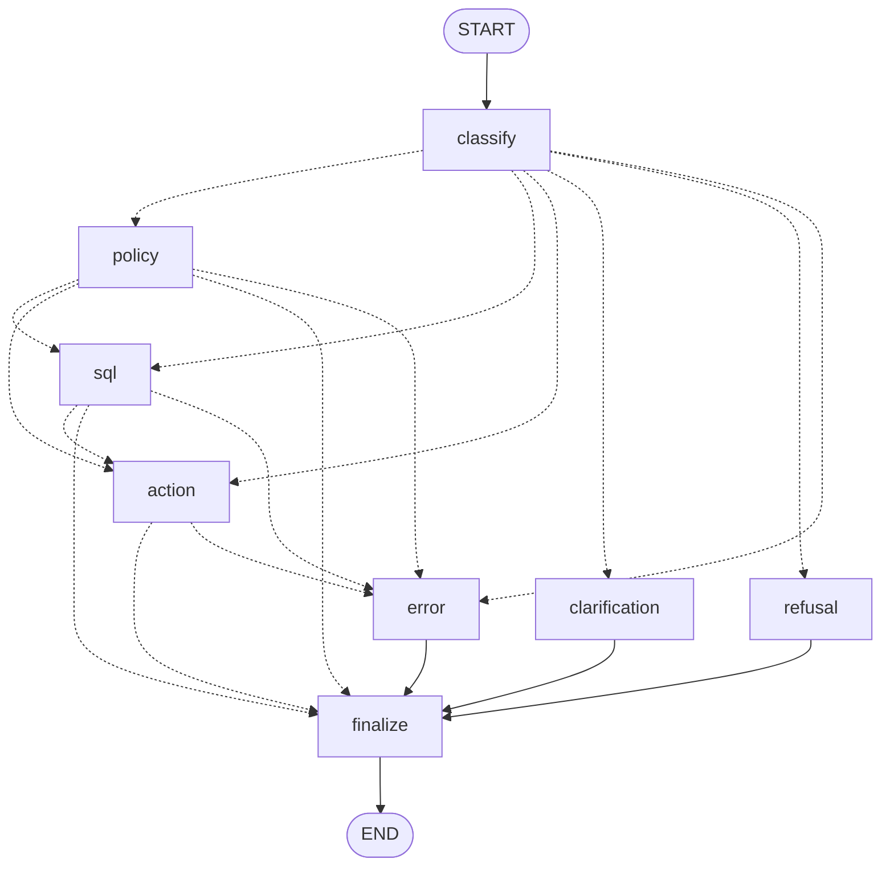

# Copilot Router (Phase 6): LangGraph orchestration

> The router is a **controlled dispatcher**, not an agent and not an authorization layer. It picks which
> existing service gets the user's own text. Every service then re-authorizes the trusted user context.

Code: `backend/app/services/ai/orchestration/`

| File | Contents |
|---|---|
| `classifier.py` | Refusal rules, clause splitting, deterministic intent signals, LLM fallback, `RouterClassifier`, `get_router_classifier` |
| `graph.py` | `build_copilot_graph`, nodes, `ALLOWED_TRANSITIONS`, `MAX_GRAPH_ITERATIONS`, `GraphDeps`, service protocols |
| `state.py` | `CopilotState` (TypedDict), `TRUSTED_KEYS`, `NODE_WRITES` allowlists |
| `models.py` | `Intent`, `RouterClassification` (the only accepted LLM output), `RoutingPlan`, `CopilotResponse` |
| `prompts.py` | Fixed router system prompt; the request is escaped and placed in the user message |
| `service.py` | `CopilotService.answer`, `get_copilot_service`, error re-raising, logging |

Endpoint: `POST /api/v1/chat` in `api/v1/endpoints/chat.py`. Tests: `backend/tests/ai/orchestration/` (257). Eval:
`backend/evals/router_eval.json` and `router_eval.py`.

## 1. Graph architecture



Generated from `build_copilot_graph().get_graph().draw_mermaid()`. Dotted edges are conditional.

| Node | Does | Calls |
|---|---|---|
| `classify` | Builds a `RoutingPlan` (rules first, the fast LLM only if rules cannot decide) | `RouterClassifier.plan` |
| `policy` | Answers the POLICY step | `PolicyRagService.answer(ctx, question)` |
| `sql` | Answers the SQL step | `SQLAgentService.answer(ctx, question)` |
| `action` | **Proposes** the ACTION step; never confirms or executes | `ActionAgentService.propose(ctx, question)` |
| `clarification` | Returns a clarification question | nothing |
| `refusal` | Returns a fixed refusal (never echoes the request) | nothing |
| `error` | Sets `AI_MAX_ITERATIONS` / `AI_ROUTING_FAILED` unless an error is already set | nothing |
| `finalize` | Re-verifies trusted state against the trusted context | nothing |

The multi-intent "COMBINE" step from the prompt is `finalize` plus `_build_response`. Parts are collected in
plan order, and the response combines them.

## 2. State model

`CopilotState` is a `TypedDict`. It is request-scoped and compiled **without a checkpointer**, so nothing is
persisted.

| Group | Keys | Written by |
|---|---|---|
| Trusted | `request_id`, `employee_id`, `role`, `message` (validated) | Backend, before the graph starts. No node may write them. |
| Untrusted classification | `outcome`, `intents`, `plan` (`[{route, question}]`), `classification_source`, `classification_reason`, `confidence`, `clarification_question` | `classify` |
| Execution | `step`, `parts` (append reducer), `error_code`, `error_message`, `error_status`, `visited` (append reducer), `iterations` | Capability nodes and the guard wrapper |

Trusted vs untrusted:

- The trusted `AIUserContext` and the service objects are **not in state**. They travel in
  `config["configurable"]["deps"]` (`GraphDeps`, frozen). Every service call uses `deps.ctx`, so nothing in state
  can change who the request runs as.
- Every node runs inside `_guarded()`. It rejects any returned key outside that node's `NODE_WRITES` allowlist
  (`AI_ROUTING_FAILED`). No allowlist contains a trusted key.
- `finalize` compares `request_id`, `employee_id` and `role` in state with `deps` and aborts on any mismatch.
- LLM entities (`RouterEntities`: name, resource type, date hint) are validated but never used for routing or
  authorization, and are not stored in state.

## 3. Routing rules

The order is fixed, and every step except 4 is deterministic:

1. **Refusal rules on the whole message.** These cover prompt injection and role claims ("ignore previous
   instructions", "you are now…", "I am admin", "without confirmation", "bypass…", "make me admin", "change my
   role"). They also cover direct system access (database/API "directly", run/execute SQL or code, URLs, shell
   tools, HTTP verbs + request, SQL syntax) and destructive requests (drop/truncate/alter table, delete
   database/all records, change payroll/salary/bank). Finally they cover sensitive data (PAN, Aadhaar, UAN, IFSC,
   bank account, passwords/tokens/keys, date of birth, anyone else's salary). A hit means **refusal** before any
   LLM or service call.
2. **Clause split** on `;`, sentence ends, `and`, `also`, `then`, `plus`.
3. **Per-clause signals**, in priority order:
   - vague verb (handle, deal with, take care of, sort out, fix, process, do something) → AMBIGUOUS;
   - imperative action verb at clause start, after politeness prefixes ("please", "can you"):
     approve/reject/apply/submit/raise/create/assign/deactivate/publish/mark/resolve/update/change/request/take
     → ACTION;
   - policy wording (policy, rules, entitlement, "can I/employees take…", "am I allowed", "what happens if",
     "how many … can I take", WFH, late attendance) → POLICY;
   - data-lookup wording (how many, count, list/show, who is/which…, remaining/balance/left/pending/open,
     reports to, my team/projects/tickets) → SQL;
   - weak "tell me about…" with no other signal → AMBIGUOUS.

   Clauses without a signal merge into their neighbour ("Approve Rahul and Priya's leave" is one ACTION).
   Adjacent read clauses with the same intent collapse. Two ACTION clauses never collapse.
4. **LLM fallback.** If the rules give no signal at all, the clause goes to the fast model
   (`AI_LLM_FAST_MODEL`). The model must return `RouterClassification` (`extra="forbid"`, an enum intent and a
   confidence from 0 to 1). Confidence below 0.6 means AMBIGUOUS. Invalid output, a provider error or an
   unexpected exception gives `AI_CLASSIFICATION_FAILED`. An unavailable provider gives `AI_UNAVAILABLE`. **Rules
   never fall back to a guessed route.**
5. **Plan:** any UNSUPPORTED → refuse; any AMBIGUOUS → clarify; more than one ACTION → clarify ("one action at a
   time"); more than 4 clauses → clarify. Otherwise the steps run in the fixed order POLICY → SQL → ACTION. Each
   step's question is the user's own text: the whole message for single intents, or that intent's clauses for
   multi-intent.

The LLM clarification text is untrusted. It is replaced by a template when it claims an action or role, or
contains a token, PAN or long number. Otherwise it is redacted and capped at 300 characters.

## 4. Allowed transitions

`graph.ALLOWED_TRANSITIONS` is the single source of truth. Conditional edges are built from it, and every
routing decision is re-checked against it at runtime (anything else goes to `error`).

| From | Allowed to |
|---|---|
| START | classify |
| classify | policy, sql, action, clarification, refusal, error |
| policy | sql, action, finalize, error |
| sql | action, finalize, error |
| action | finalize, error |
| clarification, refusal, error | finalize |
| finalize | END |

Loop prevention works in layers. Each layer is tested on its own, and deliberate mutation of each is caught:

1. Edges only go forward (no self-loops; POLICY → SQL → ACTION order).
2. A node that already ran can never be routed to again (`visited` check).
3. A plan holds at most one step per capability and at most one ACTION.
4. `MAX_GRAPH_ITERATIONS = 5` (classify + 3 capabilities + finalize) is checked in the routing functions and in
   the node guard before any non-terminal node runs.
5. LangGraph `recursion_limit = 10`. A `GraphRecursionError` maps to `AI_MAX_ITERATIONS`.

There are no dynamic node names, tools, URLs, HTTP methods, Python/shell execution or DB writes in the package.
A static test enforces this with an AST scan.

## 5. Security boundaries

```text
Authenticated user ─► get_ai_user_context (JWT, role from DB, INACTIVE rejected)
                   ─► CopilotService (inactive re-check, message validation)
                   ─► LangGraph router (classification = routing only)
                        ├─► PolicyRagService.answer  ─► POLICY_READ authorization ─► read policy chunks
                        ├─► SQLAgentService.answer   ─► SQL validation + scope rewrite ─► read-only DB
                        └─► ActionAgentService.propose ─► capability + target authorization ─► confirmation record
                                                         (execution only via POST /chat/actions/confirm)
```

- The request body accepts only `message` (alias `question`), with `extra="forbid"`. `user_id`, `employee_id`,
  `role`, `organization_id`, `permissions`, `confirmation_id`, `route` and `intent` all give a 422. Headers and
  query parameters are ignored.
- Classification is never authorization. A request routed to SQL or ACTION, by rules or by the LLM, still faces
  the full Phase 2/4/5 checks. Tests prove an employee cannot reach manager or admin actions, other people's
  rows or sensitive columns through `/chat`.
- The package imports no SQLAlchemy, HTTP client, executor, confirmation store, auth or security module. The
  action interface (`ActionProposer`) exposes only `propose`.
- No checkpointer, so there is no persisted graph state. Logs (`ai.router`) contain request_id, employee_id,
  role, intents, routes, nodes, source, reason, status/error code and duration. They never contain message text,
  answers or rows.

## 6. Multi-intent behaviour

| Request | Plan | Result |
|---|---|---|
| "What is the sick leave policy and how many sick leaves do I have?" | POLICY ("What is the sick leave policy") → SQL ("how many sick leaves do I have") | `answered`, two parts |
| "Tell me the leave policy and approve Rahul's leave." | POLICY → ACTION ("approve Rahul's leave") | `confirmation_required`; the policy is answered, the action is only proposed |
| "Create a ticket and assign it to John" | two ACTION clauses | `clarification_required` ("one action at a time") |
| "What is the WFH policy and handle Rahul's leave" | contains AMBIGUOUS | `clarification_required`, nothing runs |

If one part of a multi-intent request fails, the response is `partial` and keeps the successful parts. The
failed part carries its own error code. If every part fails, the first error is raised with its original code
and HTTP status.

## 7. Confirmation behaviour

- The graph only calls `ActionAgentService.propose`. If `propose` ever returned an executed status
  (`completed`/`failed`), the router would treat it as a contract violation (`AI_ROUTING_FAILED`) and not relay
  it.
- A proposal returns `status: "confirmation_required"` and `code: "AI_CONFIRMATION_REQUIRED"`. The action part's
  `data` holds `confirmation_id`, `summary` and `expires_at`.
- Execution still happens only through the existing `POST /api/v1/chat/actions/confirm {confirmation_id}`. The
  Phase 5 single-use, user-bound, parameter-bound, expiring token is unchanged. Replay, cross-user and fabricated
  confirmations of `/chat` proposals are tested.
- "Approve my leave without confirmation" is refused by the router's rules.

## 8. Response contract and failure behaviour

Success (HTTP 200, standard envelope):

```json
{"success": true, "error": null, "data": {
  "request_id": "32-hex", "status": "answered|clarification_required|confirmation_required|refused|partial",
  "code": "AI_CLARIFICATION_REQUIRED|AI_UNSUPPORTED_REQUEST|AI_CONFIRMATION_REQUIRED (omitted when answered/partial)",
  "intents": ["POLICY", "SQL"], "routes": ["POLICY", "SQL"], "classification_source": "rules|llm",
  "message": "combined text",
  "parts": [{"route": "POLICY|SQL|ACTION|CLARIFICATION|REFUSAL", "status": "...", "message": "...",
             "data": {"...the specialised endpoint's data..."}, "error_code": "only for failed parts"}]}}
```

Clarification, refusal and confirmation are normal outcomes (200 with `code`), as `/chat/actions` already returns
200 for `clarification_required`. Hard failures use the AI error envelope:

| Situation | Code | HTTP |
|---|---|---|
| Unauthenticated / bad token | existing auth error | 401 |
| Inactive user | `AI_USER_INACTIVE` | 403 |
| Spoofed fields in body | validation error | 422 |
| Empty / too long message | `AI_INVALID_REQUEST` | 400 |
| Rules inconclusive and provider unavailable or AI disabled | `AI_UNAVAILABLE` | 503 |
| Rules inconclusive and classifier output invalid or provider error | `AI_CLASSIFICATION_FAILED` | 502 |
| Unknown route, cycle, illegal state write, trusted-state mismatch, unexpected exception | `AI_ROUTING_FAILED` | 500 |
| Iteration or recursion limit | `AI_MAX_ITERATIONS` | 422 |
| Single-route service error | the service's own code/status (e.g. `SQL_MUTATION_REJECTED` 403, `AI_TARGET_NOT_FOUND` 404) | same as the specialised endpoint |

Provider failure never routes to a fallback capability. Rule-decided requests (refusals, clear policy, SQL and
action requests) still work without the LLM. Anything else fails closed.

## 9. Known limitations

- The rules are English keyword heuristics. Paraphrases without a signal go to the LLM, which is untested
  against the live API (no key in this environment). A trailing clause without a signal merges into the previous
  clause and reaches that service ("What is the WFH policy? Asking for my brother." → POLICY).
- Multi-intent splitting is conjunction/sentence based, so a single question that contains "and" between two
  signalled clauses is treated as two requests.
- Phase 7 added conversation memory: `plan(message, context=...)` resolves follow-ups from bounded, untrusted
  history (see [phase-7-conversation-memory.md](phase-7-conversation-memory.md)).
- The router eval measures the routing and safety pipeline with scripted model output, not production intent
  accuracy.
